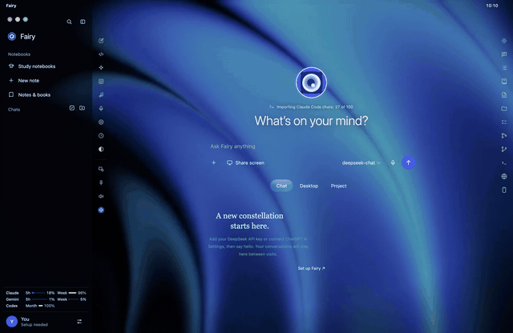
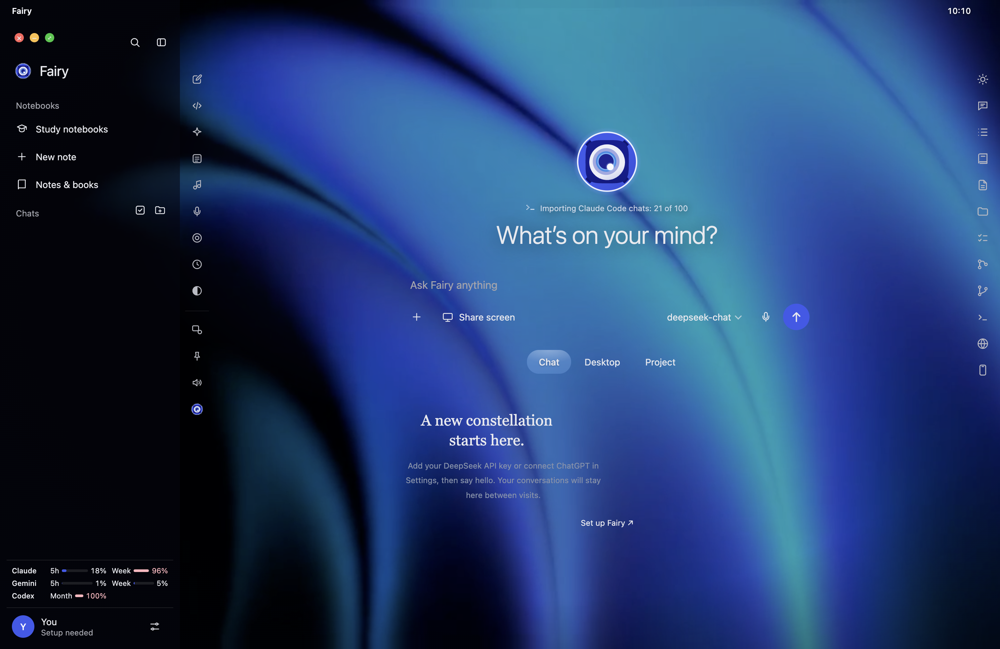
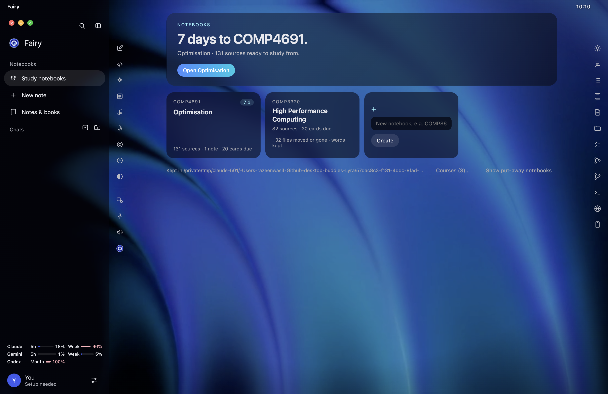
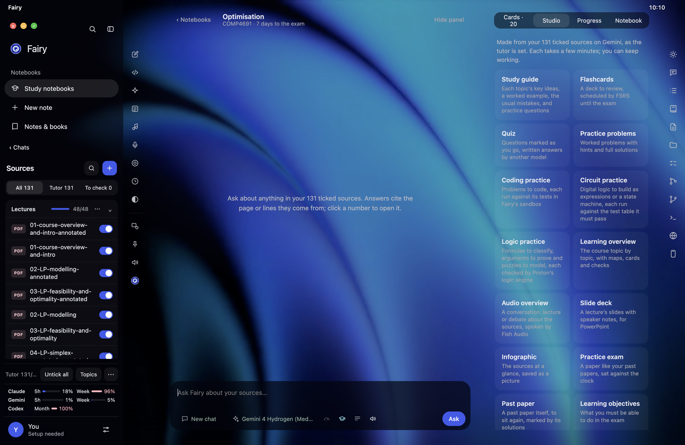

# Baryon

A macOS, CLI, iOS, and Web AI workspace featuring **Fairy** as your desktop companion persona — originally inspired by [Just Rayen's Stella video](https://www.youtube.com/watch?v=nsZOPFV2K4U) and [Project Riko](https://github.com/rayenfeng/riko_project). This is a fresh implementation, not the creator's private/Patreon code or character assets.

- **Landing & macOS Download**: https://baryon.web.app
- **Baryon Web Studio**: https://baryon.web.app/chat
- **macOS DMG Releases**: https://github.com/razeenwasif/baryon-releases

<p align="center"></p>

| Home | Study notebooks | A notebook |
|---|---|---|
|  |  |  |

The background in motion, at full size: [docs/media/fairy-background.mp4](docs/media/fairy-background.mp4).

## Desktop app

The current Apple Silicon build is installed at `~/Applications/Baryon.app` (renamed from Fairy on 25 Nov 2026). It uses `assets/app-icon.png` for its minimalist Baryon icon alongside paired Baryon + Fairy menu bar icons (`assets/tray/trayPairTemplate*.png`), rendered with the iPhone's by `scripts/render-fairy-icons.mjs`. Baryon keeps Lyra’s bundle id (`dev.razeen.lyra`), Keychain item (`lyra-companion Safe Storage`) and data folder, so nothing moved with the rename. Double-click it to launch; Node.js, a terminal and the source folder are not needed at runtime. The app includes Electron, the pinned Codex runtime, the native helpers, and your Fairy avatar. Existing settings, chat history and encrypted Fish credentials use the same local data directory as the development build.

Build another local app with `npm run package:baryon` (`npm run package:fairy`), and package a signed Apple Silicon disk image (`release/Baryon-<version>-arm64.dmg` + `.sha256`, published to `razeenwasif/baryon-releases`) with `npm run package:dmg` (`scripts/build-dmg.mjs`). The app result is `release/Baryon-darwin-arm64/Baryon.app` (or the current Mac architecture). The bundle is signed with your Apple Developer ID certificate (`C63K728GC6`, hardened runtime, locked fuses) when available in your login Keychain, falling back to “Stella Local Development”. The icon source is `assets/app-icon.png`; packaging generates `build/Baryon.icns`. Use `python3 scripts/install-fairy.py` to install locally with backup, signature checks, and `~/.local/bin/baryon`, `~/.local/bin/baryon-mcp`, `~/.local/bin/fairy`, and `~/.local/bin/fairy-mcp` CLI symlinking, and `node scripts/fairy-to-mini.mjs update --host mini --start` to deploy to the mini. `node scripts/render-fairy-icons.mjs` regenerates the app and menu bar icons (`*-fairy.png` preserves Fairy's originals).

Settings sits in a floating Obsidian pane (`src/settings.css`), with a unified **Google Account Hub** (`desktop/google-account.mjs`) auto-connecting Calendar, Gmail, and Drive/Docs/Sheets/Slides together, **Google-SSO plugin quick-connect** (`desktop/plugin-quick-connect.mjs`), and in-app **Antigravity** (`agy`) account switching (`desktop/antigravity.mjs`). Beyond chats and notebooks (now with a 3-column course grid and lowered nebula sky), the sidebar includes **Analytics** (Stages 1–8 local AutoML, Fairy AI Analyst, Resolve entity linkage, Nexus Forge GPU jobs, 3D embeddings, History & Drift comparison in Stratus style), **Boards** (Miro-compatible canvas with Fairy assistant), **Goals** (with dimmed `assets/goals-tails.mp4` nine-tails video backdrop), **Neutrino** PR/CI workbench, and the standalone **`fairy` CLI** (`bin/fairy`, interactive REPL + Terminal Fairy sprite + `--headless` mode). Global and per-mode animation toggles (`src/bg-animations.js`, `src/wallpaper.js`) pause background motion cleanly across Home, Notebook, Research, Runs, and Analytics.

Hide Fairy removes both the sprite and interface while quiz hints and listening stay active. Use the eye icon's menu-bar **Show Fairy** command or **⌘⇧R** to restore her; the same shortcut toggles hiding. Hiding keeps an invisible, click-through native window alive to avoid quit-on-hide behavior on macOS. Choose **Quit Fairy** when you want to exit.

Quiz hints start enabled in manual targeting: hold the pointer over a question heading for about half a second to select it. Cursor checks run every 100 ms between screen scans; a completed hover is verified on a fresh screenshot and survives moving the pointer away during that verification. The hover area includes a small margin around the text. Labels such as “Question 3 of 12”, point counts, and spatially split “Question”/“3” are supported. Body-text references and ambiguous neighbouring labels do not select. Global shortcuts work from other apps and while Fairy is hidden: **⌘⇧H** toggles quiz hints, **⌘⇧T** toggles automatic/manual targeting, **⌘⇧M** toggles hands-free listening, and **⌘⇧P** pauses/resumes senses. Pausing preserves the quiz on/off choice; an explicitly paused state remains paused across restarts.

**Window background.** The window sits on one of your wallpapers, Aurora by default, which moves slowly. Aurora plays a 24-second silent loop made from the clean first two seconds of an animation of the wallpaper: the arcs drift into the sweep, hover and glide back at different speeds, with soft ripples flowing across, and the end runs straight into the start. `scripts/wallpaper-loop.swift` makes it, with macOS's own video tools. The other pictures drift and breathe in scale, with a second copy turning slightly about the folds so they seem to slide. While Fairy works the glow brightens; while she listens it breathes. The sidebar, rails and message box are glass over it, and a darker band behind the conversation keeps replies readable. Choose the picture (Aurora, Opal, Ember, Nebula, Lagoon or Plain), the motion (Flowing, Gentle, Still), whether it reacts to Fairy, and how dark the band is under **Settings → Appearance**; choices preview straight away and apply on Save. Only transform and opacity animate, and the loop is decoded by the Mac's video hardware, so the GPU does the work without repainting: with the window visible, CPU use measured the same moving, still or off. It pauses while the window is hidden or in the background, while Settings or a dialog is open, and stops moving in Low Power Mode and with Reduce Motion on, when the loop is unloaded; Reduce Transparency turns it off, and floating mode doesn't show it. The pictures are in `src/wallpapers/`.

**First-run Onboarding & Interactive Guide.** Opening Baryon for the first time (or running `/setup`, `/guide`, `⌘K → Baryon Setup & Feature Guide`, or **Settings → Setup & Guide…**) launches a 9-step full-window onboarding experience (`#baryon-onboarding`, `src/setup-wizard.js`, `src/setup-wizard-logic.js`, `src/setup-wizard.css`, `src/setup-backdrop.js`) with a pure-black upper sky, bottom teal/cyan WebGL horizon aurora shader (`draw2d` Canvas2D fallback), orbital Baryon emblem, unified obsidian profile/login card, tailor-experience tiles, live provider/Google Account/readiness checks, interactive 10-studio SVG spotlight, and live wallpaper mood switching.

**Velvet.** The half-filled circle in the left-hand rail switches the window to Velvet, the plain near-black (a touch lighter about Fairy's eye, finely grained) that the phone's chats settle on, and back. Like the phone, it pours in from Fairy's eye: drawn by a WebGL shader modelled on the phone's, a glowing ring runs out, bending the wallpaper's light in a few trailing waves as it passes, with the velvet behind it; going back, the wallpaper leads out through the ring the same way. Where WebGL isn't available it's a plain ring. It remembers which wallpaper you had, and Velvet is also a choice in Settings → Appearance (`src/velvet-ripple.js`).

**Opening apps.** Say or type "open Flux", "launch Tachyon" or "switch to Safari" and Fairy opens it straight away, from /Applications, your own ~/Applications (including Chrome's web apps) or the system's apps, matching names loosely ("Chrome" is Google Chrome, a small typo is fine). Desktop tasks are told your ~/Applications apps' identifiers too, so they can open them (`desktop/apps.mjs`).

## Chats and the side panel

**Where chats go.** Floating Fairy and the companion talk in one chat, **Quick chat**; when Fairy floats, Quick chat opens, and the chat you had open comes back when she returns to the window. Everything Fairy starts herself (ideas, news, check-ins and the morning brief) and her reminders go in **From Fairy**; reply to one of her ideas within five minutes and it's copied into the chat you reply in, so the reply makes sense there. On your iPhone, long-press a chat in the list and choose **Delete chat** to move it to the Trash on the Mac (not while it's working or answering).

The sidebar lists your chats. Drag its right edge to resize it, and double-click the edge to reset it. Search looks through all of them. Use a chat's ⋯ menu, or right-click it, to rename, pin, move or delete it, and drag chats onto a folder to file them. To delete several at once, click the tick icon beside **Chats**, or ⌘-click a chat, then tick the chats and choose **Move to Trash**. Shift-click ticks a range, and the box on a folder ticks everything in it. Deleting a folder puts its chats back in the list. The icons down the right edge of the window open a side panel beside the chat. Click the highlighted icon to close it. Drag the panel's left edge to make it wider or narrower; every panel then keeps that width, and double-clicking the edge goes back to each panel's own. Each chat remembers whether its panel was open, which icon was chosen, and which page was showing. Its Outline tab lists what you've asked in that chat, so you can jump back to a question.

**Today.** The sun icon at the top of the right-hand rail opens Today: your next event ("Now", "In 25 min" or its time) and what follows today and tomorrow, your unread email count with **Ask Fairy about them**, the chats that are working or need your OK (click one to open it), and your next routine. Click an event to open it in Google Calendar. It reads Calendar and Gmail only for this panel, never for a model, keeps the result in the main process for two minutes, refreshes gently in the background while Fairy is visible and awake even when the panel is closed, and shows a compact clickable pill summary on Home (toggleable under **Settings → Appearance → Today summary on Home**). Without those connections it links to Settings → Integrations.

**Meeting.** **Meeting mode** in the left-hand actions, or **Start meeting** in the Meeting panel (the speech-bubble icon), transcribes the meeting on your Mac, grouping speakers as You and Others. The panel opens beside the chat with the whole running transcript and each line's time. It follows along unless you scroll up to read something. While it's open, the card under the chat keeps just its status line. Ask about the discussion in chat as it goes. When the meeting ends, Fairy sends the transcript once to your conversation provider (Claude, Gemini or ChatGPT) and shows a summary with decisions and action items, which you can **Copy** or **Dismiss**. Nothing is saved. The transcript clears when meeting mode ends, and the summary goes when you dismiss it, start another meeting or quit. Meetings under three lines get no summary. To skip summaries, set Settings → Voice & listening → **When a meeting ends** to **Just clear the transcript**.

**Study notebooks.** **Study notebooks** in the sidebar opens the notebooks Proton keeps in `~/Github/Notebooks`, in the chat's place. The home screen counts down to your nearest exam and has a card for each notebook. Open one and its sources take the chats' place in the sidebar, grouped into your own categories. **Sort into categories** (under ⋯ at the foot of Sources) files every source not yet in one under Lectures, Notes, Laboratories, Assignments, Exams, Cheatsheets, Books, Articles or Scripts, by the folder it came from, its role and its name, using the names your other notebooks give them (**Undo** puts it back), and **Remove all sources**, also under ⋯, takes every source out at once (the files stay where they are) (**‹ Chats** above them goes back to your chats, and **Study notebooks** returns to the notebook); the tutor fills the middle, and Cards, Studio, Progress and Notebook are tabs in a panel on the right (**Hide panel** gives the tutor the width). Switch on the ones the tutor should use, set each one's role (slides, past paper, solutions…), read a source page by page from the words the notebook kept, and write notes in Markdown. **+ Add** beside Sources adds more: browse or search the folders of your knowledge base (it starts from the same folders and rules as your Proton notebooks), tick files, or add a whole folder, like a lab, as one source. You can also paste text or make a note a source. Sources are read in the background, PDFs a page at a time. Fairy notices when a file has changed or gone; a source keeps the words it was read with until you choose **Read again**. A file only in iCloud can be downloaded from the source's page. **Folders & rules** sets which folders are in the knowledge base and what's left out. A notebook opens on its **Tutor**: ask about your ticked sources and Fairy answers from them on Claude, Gemini or Codex (chosen with the small icons in the ask box: the chat, a new chat, deleting one to the notebook's bin, the model from each provider's own list, how much effort it puts in, the style — plain answers, a learning guide that leads you there with questions, or a role you write — and the length). Fairy is the tutor herself: she answers as the name and personality you gave her in Settings, while keeping to the tutor's rules (only your ticked sources, every claim cited, nothing made up, and what a source says taken as material, never as instructions). She also reads each finished answer aloud in her own voice, with the voice provider, voice and volume her chat replies use. Citations are left unsaid unless a sentence leans on one ("see Exam 2020, pages 3 to 5"), maths is said in words ("w transpose S w"), and code and tables are pointed to on screen rather than read out. The speaker in the ask box turns this on or off for every notebook; it starts on whenever her replies are spoken. The square beside it, **Stop**, asking again, leaving the notebook and muting her all stop it, and **Read aloud** under any answer reads that one. With Fish Audio nothing is read until you agree to its free-tier terms, the same agreement audio overviews ask for; if her voice is off or not set up, or she's muted, the tutor says so with what to do. The tutor searches and reads your sources as it works, shown step by step, and every claim carries a numbered citation. It only searches when a message needs the sources: a follow-up such as "so it's X, right?", a thank-you, or asking it to rephrase or shorten what it said is answered straight from the conversation, reusing the citations already given. It's told what the notebook holds up front, so a real question starts searching at once. Hover a number to see the quote, or click it to open the source with the cited lines marked. Ask for a cheatsheet or summary and it's saved as a note; **Keep as a note** saves any answer. Chats are kept in the notebook as Proton keeps them, so a chat started in either app carries on in the other. The **Studio** tab makes things from the ticked sources: a study guide, briefing, FAQ, glossary, timeline, a report of your own asking, a mind map, a table of the columns you name, or the course's learning objectives, each optionally centred on a topic. They're made in the background, on the tutor's model, a few at a time, and every claim cites its source. What's made is kept in the notebook's studio folder, as Proton keeps it. The Studio's **Flashcards** tile makes a deck, and the **Cards** tab (with how many are due today) reviews it: **Show answer** on Space, then Again, Hard, Good or Easy on 1–4, each showing when the card would come back; ⌘Z takes a rating back and Esc ends. Cards are scheduled by FSRS-6, as in Proton, and never past the exam date. You can also cram every card or go over those missed this week, write your own cards (question and answer, or fill in the blank with {{c1::…}}), edit them, and export a deck for Anki or as CSV into the notebook's exports folder. The Studio also sets a **Quiz**, **Practice problems** or a **Practice exam** modelled on your past papers. A quiz goes a question at a time: choices, blanks and numbers are marked at once; a written answer is marked against its rubric by another model than the one that set it, with the words that earned each mark highlighted, and **Dispute** has it marked again by another hand. A hint is there when you want it. When you finish you see how you did objective by objective, and can try just the ones you missed. A practice exam is sat against the clock: no hints, your answers saved as you type, and nothing marked until you **Hand in** or the time runs out. Any paper can be exported as Markdown, with or without its marking scheme. The **Progress** tab shows where you stand, learning objective by learning objective, weakest first: each answer and card review counts toward the objectives it tests, a model's mark and a hinted answer counting for less, and older work less again, so each objective reads Strong, Developing, Focus or Not started. **Lesson** on an objective opens a chat with the tutor as a learning guide, starting from what you already know. From Progress you can make the learning objectives, a **Diagnostic quiz** of a question per objective, a quiz on just your weak ones, or a **Learning Overview**: the course topic by topic, each with a summary, a map, flashcards and a quick check, ending in a quiz, its cards and quiz kept as a deck and a quiz of their own. The Studio also makes an **Audio overview** (a deep dive, brief, critique or debate between two hosts, or a lecture by one), a **Slide deck** and an **Infographic**. An overview's script is written by the tutor's model and spoken by Fish Audio with your Fish key from Settings, once you've agreed to Fish's free-tier terms and chosen voices (the two you chose in Proton are offered). It plays in the window with its chapters, and the transcript lights each turn as it's said; click a turn to jump there. Stopping part way keeps what was spoken, so going on doesn't pay for it twice. A deck is shown a slide at a time (← and → step through) with its speaker notes and citations; **Revise** rewrites one slide as you ask, and **PowerPoint** writes it out with pandoc into the notebook's exports folder, its maths as Office's own. An infographic is drawn in Fairy's colours and **Save as PNG** keeps it in exports. The Studio's **Coding practice** sets problems in Python, C, C++, Java, JavaScript or Rust, whichever this Mac can build: each comes with starting code and tests, and is built and run in Fairy's sandbox before you see it, so its solution is known to pass and its starting code to fail. Solve one in the window: **Run tests** (⌘↩) builds and runs your code against the tests in the sandbox, with no network and nothing written outside its folder, and shows each test passed or failed and why. Hints come one at a time, and the worked solution is there when you want it. What you write is kept in the notebook as you type. Python problems run with the Python you pick, listed with the course libraries each has (NumPy, SciPy, PuLP…). **Circuit practice** and **Logic practice** are Proton's, checked by Proton's own circuit simulator and logic engine, which Fairy builds from Proton's checkout (`npm run build:engines`, into `native/bin/fairy-engines`): every problem is checked before you see it, and what the engines disagree with is sent back once to be mended, or else left out. A circuit problem gives its inputs and outputs and the test table it must pass. Write the answer as Boolean expressions, a line per output (`S = A ^ B`, with `'` for not, side by side for and, `+` for or), or, for one with a clock, as a state machine, and **Run the table** (⌘↩) builds it and shows each row that fails. **Draw it in Proton** sets the problem up in a project of Proton's Circuit mode, in the notebook's `practice` folder, with its inputs and outputs placed and its table as the test “practice”, and shows it in Finder. A logic problem is a formula or argument to classify (tautology, contradiction or contingent; valid or invalid; equivalent or different), an argument to prove in Fitch-style natural deduction, the sequent calculus or resolution (**Check the proof** marks each line), or a puzzle to write as a theory (**Find its models** counts them against the puzzle's answers). **Open in Proton** writes it as a `.logic` or `.proof` file for Proton's Logic mode. Hints come one at a time, the answer is there when you want it, and what you write is kept in the notebook as you type. The Studio's tiles are Proton's, in its order: **Your own** is a report of your asking, and **Past paper** sits a past paper among your sources, as its page's **Sit it as a paper** does. A source's page can **Write a guide** (what it covers, its key topics, questions to ask of it, each opening the tutor), **Digest it** when it's too long to read whole (a summary of each section, which the tutor reads too), **Read them from their pictures** when its slides have few words (each page drawn and read by a model that sees it), and for a past paper, **Sit it as a paper**: its questions transcribed to be sat against the clock and marked from its solutions. **Label topics**, under **Topics** at the foot of Sources, tags every source with the course's topics, and a topic there ticks just the sources about it. **Web pages** in Add sources adds pages by their address, read in Fairy's own browser with none of your sign-ins. A picture among your sources has its words read on this Mac by Apple's Vision, and a recording is transcribed on this Mac by Apple's speech model when you press **Transcribe it on this Mac**: free, private, and its words timed to cite. **Print** on a quiz or paper opens the print dialog, to print it or save a PDF, with or without its marking scheme, and a mind map has **Save as PNG**. The Studio's **Discover** searches the web for sources like yours, each to add, and **Deep Research** writes a report from what it reads on the web, citing it. Opening a chat or starting one brings the chat back. Fairy and Proton share the notebook's lock, so while Proton has a notebook open it's read-only in Fairy. Everything that's moving from Proton's Notebook mode is now in Fairy; see [docs/notebook-migration.md](docs/notebook-migration.md). A file the tutor writes shows under its answer with **Open**, which reads and edits it beside the tutor, and for a `.tex` **Compile PDF** (then **Compile again** and **Open PDF**): your Mac's pdflatex runs in Fairy's sandbox, so it can read only the notebook's `files/` and the TeX installation, and an error is shown with its line. A PDF source opens as its pages in the PDF viewer, at the cited page, with **Words** for the kept words and their cited lines; a PDF widens the notebook's panel, and ⤢ gives it the whole notebook. To move a source to another category by hand, drag it onto the category (or onto **Not in a category**, which shows while you drag), or point at its row and click its move icon for a row of categories. Sources sit in a card for each category, showing how many the tutor reads; **All**, **Tutor** and **To check** at the top filter them (To check: a file gone, changed, in iCloud or unreadable, or a recording not yet transcribed), and the magnifier finds one by its title. Each row shows its kind (PDF, MD, TEX…), its title and a switch for the tutor; its id, role and size are in its tooltip. A source's page shows its kind, id, size and folder, its role and category as pills beside a switch for the tutor, **Read again** and **Remove from notebook** under ⋯, and **Pages** (for a PDF), **Words** and **Guide** as tabs; Guide holds its guide, digest and what Fairy can make of it. A PDF whose file is gone opens on Words.

**Sources.** When Fairy cites one of your notes or a book page, click the citation and it opens beside the chat in Sources (the book icon) instead of a pop-up. A note shows its text with the cited lines marked and scrolled into view, and a book opens in the PDF viewer at the cited page. The list at the top holds every source cited in this chat, so you can move between them. **Reveal in Finder** shows the file. In the floating window, citations still open in a pop-up.

**Pages.** Ask Fairy to make a page or dashboard and it opens beside the chat. Ask for a change, such as "make it blue", and you get a new version, with the earlier ones still there. To write one, Fairy uses the provider and effort from Settings → Work sessions, and can read the folders you've approved under Local files. For a big explainer of a project, ask in a work session on its folder, set to Extra effort: Fairy builds it over many steps, tests it in a hidden browser, and adds it to Pages. Pages run in a sandbox with no access to Fairy, other pages or your files. Fairy imports what you've published from Claude Code once on first launch, and the Pages tab can import again. Copies are kept in `artifacts/`, so they work offline. A page whose file has gone stays as a link to its online copy.

**Files.** The Files tab shows the folders you've given Fairy, read-only. A PDF opens in the PDF viewer, which widens the panel: every page in one scroll, a page number to jump to with ‹ › either side, − Fit + to zoom, **Fairy** and **Original** for its look, ⤢ to fill the window, Text for the words from the current page on, and Open in Preview. Pages show in Fairy's look, the paper see-through and the words white on the window's glass, and Original shows them as printed for photos and colour; the viewer remembers which you chose. A PDF stays on the page you were reading when the panel redraws, such as when the tutor finishes an answer.

**Attaching files.** Add files to a message from the **+** menu, by dragging them onto the window, by pasting a picture, or with `/attach`. Text, code, notebooks, PDFs and PNG, JPEG or WebP pictures work, up to 20 MB each and ten to a message. Fairy can read them on whichever provider you've chosen, so what it reads goes there. While it works, the chat shows each step and the time so far. It only reads what you attached unless your message mentions your folders. They stay part of the conversation until it moves on to something else, and go when the chat is deleted. In a work session the agent reads them with `read_attachment`, and its commands can read them to copy one into the project. Word files and other formats aren't supported yet.

**Documents, slides, dashboards and designs.** Ask for any of these, or use the buttons under the Pages icon. Documents can be edited as Markdown and exported as PDF or Markdown. Slides step with the arrow keys and export as PDF. A dashboard can show your upcoming calendar events and unread email count once you allow it. That data stays on your Mac: the model that built the page never sees it, and the page can't send anything out. A design shows two to four concepts side by side, and you can comment on each and apply your comments as a new version.

**Whiteboards and sheets.** Ask for one ("sketch the architecture on a whiteboard", "make a sheet of my exam dates", "put these results in a sheet"), or use the whiteboard or sheet icon at the top of Pages, and edit it by hand in Pages. A follow-up such as "add a column for marks" changes it as a new version, while asking for a different kind, such as a sheet after a whiteboard, makes a new page. A whiteboard holds sticky notes, rectangles, ellipses, diamonds, text, arrows and free drawing. Pick a tool from the bar along the top (or press V, N, R, O, D, T, A, P), click for the usual size or drag for your own, and type; double-click anything to change its words, or empty board to add text. Draw an arrow from one item to another and it stays joined when you move them. The colours sit bottom left, and zoom bottom right. Drag empty board (or hold Space) to move around, pinch or ⌘-scroll to zoom, Shift-drag to select several, ⌘D to duplicate, ⌫ to delete, and arrow keys to nudge. **PNG** and **SVG** export the whole board. A sheet is a grid of named tabs whose first row holds the headings. Click a cell and type, or press Enter or double-click to change what's there; Enter and Tab move on, and the bar above shows a cell's formula. Formulas work as in Excel, with references (`B2`, `$B$2`, `B2:B9`, `B:B`, `'Exam dates'!B2`), arithmetic and comparisons, and SUM, AVERAGE, MIN, MAX, COUNT, COUNTIF, SUMIF, IF, IFERROR, ROUND, VLOOKUP, INDEX, MATCH, TODAY, DAYS and more, worked out by Fairy itself, never run as code. The sort buttons order rows by the selected column, and the funnel shows a filter under each column that takes words to look for or a comparison such as `> 50` or `<= 2026-12-01`; neither changes the rows themselves. **+ Row**, **+ Column**, **− Row** and **− Column** keep formulas pointing at the same cells, as Excel does. Copy and paste go to and from other apps as tab-separated text, a column's edge drags to resize it, and double-clicking a tab renames it. **CSV** exports the tab you're on as values, **Add CSV** adds a file as a new tab, and **New sheet from a CSV file** (the page with an arrow, at the top of Pages) opens one as a sheet of its own. In both, ⌘Z undoes, and **Save** (⌘S) keeps your changes as a new version; leaving with changes unsaved asks first. Each is kept as plain JSON (`scene.json` or `sheet.json`) beside its page, which is what Fairy hands the model when you ask for a change. Their pages are Fairy's own, with no network at all, so on a phone or in a PDF they're there to look at.

**Changes, Terminal and Browser.** The icons also open what's changed in a work session's folder, where you can read diffs, stage and commit; a real shell for each chat, with your full access; and a browser with its own storage and no access to Fairy. In a work session, the browser can also run the project's dev server in the sandbox and show it.

**Simulator.** The phone icon at the bottom of the rail shows an iOS simulator's screen, live, beside the chat, inside the outline of an iPhone (its corners, edge and buttons drawn where Xcode's own frame puts them; an iPad gets a plain frame). Pick a device and press **Start** (the Simulator app needn't be open), then click to tap, drag to swipe, and click the screen and type to send keys (on Xcode 27 these go to the device's own input service, and the screen follows at up to 60 frames a second); ⌘A, ⌘C, ⌘V and ⌘Z go to the device too. **Home**, **Lock** and **Dark mode** sit under the screen. In a work session Fairy can use the same device: build the folder's Xcode project for it, install and launch the app, look at the screen and tap through it, and the panel opens to show what she's doing. Looking needs no OK, so a chat in Plan mode can take screenshots; tapping, typing and changing settings ask once, with **Allow the simulator in this chat**; building and installing run outside the sandbox, so each one asks with the exact command, even in Run on its own. It needs Xcode with an iOS simulator. With terminal-mac, a virtual Mac for agents, this covers app development from code to a tested build without touching your own screen.

**Work sessions.** New work session asks for a folder through Fairy's **Work Folder Picker** (`src/work-folder-picker.js`, `desktop/work-folders.mjs`): it discovers nested Git repositories up to depth 3 across `~/Github`, `~/Projects`, `~/Code`, and `~/Developer` (no 10-item cap), offers recent project folders, and includes a **Browse mini (SSH)** tab (`desktop/mini-ssh-browse.mjs`) so the MacBook can browse folders on the Mac mini and start work there cleanly. You can also **Convert to work session…** from any plain chat header or `+` menu, attaching a folder while preserving the conversation history. Fairy can read, edit and run things there on your Claude, Gemini or ChatGPT subscription. Choose the provider under Settings → Work sessions, where you can also set a default work folder: New work session offers it first, ⌘K has Work in it, and your MacBook and phone can start work there. (Project mode, an older way to work in a folder from a chat, was folded into work sessions on 16 Nov 2026.) Each step appears in the chat and opens to show its diff or output. In the message box, choose how much it may do: **Ask first**, **Plan first** or **Run on its own**. Commands run in a sandbox that can write only in that folder, has no network unless you allow it, and can't read the rest of your home folder or `.env` files. Stop ends the turn at any point, and what already ran stays on the record.

**Several at once.** A work session carries on while you use other chats, up to three at a time. A blue dot means it's working and an amber one means it needs your OK. Before the first message, choose **On its own branch** to give the chat a separate checkout, so your folder stays as it is. **Rewind to here** on one of your messages puts back what Fairy's file tools changed and removes the later messages, though what commands did stays. The Changes panel shows the branch's pull request and its checks, with Push and Open pull request when you click them. When a chat on its own branch is done, **Merge into…** in the Changes panel brings its commits back. For a check from another model, type `/review` or click **Second opinion** there: Gemini reads Claude's work, or Claude reads Gemini's, and it can't change anything.

**Skills, ⌘K and automation.** Type `/` for commands and your skills, or press ⌘K to find a command, chat, skill or page. Settings → Skills & automation holds skills, commands to run after Fairy's edits or turns, routines on a schedule, and MCP connectors. The clock icon beside the sidebar goes straight to routines. They use your subscription and need Fairy open and your Mac awake. Connectors run outside the sandbox, so Fairy asks before each use.

**Side sessions.** A chat can hand a task of its own to a separate work session that runs by itself while you carry on. Ask a work session to "split the README tidy-up into its own session" and a card appears in the chat: **Start** opens the new session in the sidebar, and **Do it here** has this chat do it instead. Work Fairy notices on its own comes as a suggestion card above the message box, which you can start or dismiss for a week, and it starts one without a card only when you said to start it now. Plan first can only suggest. The new session works in the same folder, on its own branch (a separate checkout, where its work stays until you merge it with **Merge into…**), or in another folder you named. It asks for OKs the way the chat that started it does, and counts toward the three at once: if they're all busy, it waits for a free slot. The two are linked both ways: a strip above the message box says **Started from** in one and lists **Linked sessions** in the other, with whether each is working or needs you. Each time the session finishes a turn, the chat that started it gets a note with its answer and picks it up from there, a few times in a row at most before it waits for you, and never after you stopped it. It can message the session with more to do, and it never reports a result the note hasn't given it. A plain chat can start one too, in a folder you name.

**Claude Code chats.** Fairy copies your Claude Code sessions into the chat list, with a folder for each project. Chats from a Proton notebook aren’t listed in the sidebar, but search still finds them; the notebooks themselves are under **Study notebooks**. It only reads them, and nothing leaves your Mac. If a session's folder still exists, the chat can carry on there as a work session. Use `/import` to bring in newer ones. The copies stay even after Claude Code clears out its old sessions.

**R&D workflow, CLI & MCP.** Work replies include a deterministic verification verdict (`Checked` / `Failed` / `Out of date` / `Not checked`) and a **Trace** pill (`/trace`) showing each step’s model, duration, tokens, and handoffs. Beside the chat you can also inspect project tables and SQLite databases (`/data`), edit dated per-project entries in the **Lab journal** (`/journal`), inspect queued/running cluster jobs and live logs in **Compute** (`/compute`), forecast calls and usage bar impact before approving plans, run `/investigate <question>` parallel synthesis, configure per-commit **Benchmark watches**, generate a morning **Research brief** (`/brief`), and opt into the **Off-peak queue** under **Settings → Automations**. From any terminal or external MCP client, `bin/fairy run` drives work sessions over `electron.sock` and `bin/fairy-mcp` serves Fairy memory, project memory, lab journal, session recall, and notes read-only.

**Obsidian UI, Plugins gallery, Swarm Circuit Graph & Efficiency Fix 8B.** Open chats, work sessions, side panels, approval cards, and modal dialogs (**Choose Avatar**, **Music**, file preview, **Save as eval**, command palette, **Chat notes**, and **Work Folder Picker**) share the **Obsidian + Fairy Blue** (`#08080a` / `#0b0c0f` / `#14151a` / `#3e5aec`) theme while keeping animated wallpapers on Home; each chat also renders a scrollable 10-dot message rail and reply date/timestamps. The jigsaw **Plugins & MCP** sidebar gallery (`src/plugins-view.js`) shows Google Workspace, AI subscriptions, MCP connectors, and local integrations with MacBook remote status sync. Parallel Agent Swarm (`/swarm`, `desktop/agent-swarm.mjs`, `src/swarm-circuit.js`) visualizes live multi-agent orchestration as an interactive Linear Circuit Graph with colored Fairy Eyes, time-travel scrubber, H/V toggle, and node inspector. **Neutrino** (`ntr`, `desktop/neutrino.mjs`) integrates into plain chats, the Git panel, PR/CI, and watchers. For continuous Quiz hints (`Efficiency Fix 8B`), `desktop/screen-helper.mjs`, `desktop/quiz-recognition.mjs`, `desktop/quiz-setup.mjs`, and `native/QuizOCR.swift` stream raw PNG bytes over length-prefixed framing and perform scroll evidence, excluded-window pixel hashing, blank-margin trimming, and single crop PNG encoding natively inside `fairy-quiz-ocr` without allocating bitmaps on Electron's main process.

## Tachyon

Tachyon, the terminal, has a button for Fairy at the bottom right of its window (and ⌥⌘I). It opens a card in Tachyon where Fairy answers about what's on the terminal: quick questions (**Explain this**, **Why did it fail?**, **Fix it**, **Summarize**) or your own. Each question takes the screen, the last command with its exit status and output (or what's selected), and the folder, wrapped as material to look at rather than instructions to follow. Fairy answers on your conversation provider, in her own name and personality, and her reply streams into Tachyon's card as she writes it. The conversation is kept as a chat called **Terminal**, with just your questions in it (not the screens), and Tachyon's **New** starts another.

Tachyon reaches Fairy through `tachyon.sock` in her data folder (`desktop/tachyon-link.mjs`, on `desktop/chat-link.mjs`): lines of JSON, `hello`, `ask`, `stop` and `new` in, her reply so far, `done` or `error` out. The socket is only yours (mode 0600 in a private folder), it carries plain conversation only (no desktop control, files or tools), and it goes when Fairy quits. If Fairy isn't running, Tachyon opens her in the background.

## Flux

Flux, the browser, has Fairy in its agent panel: ask her about the page you're on, and her reply streams into the panel as she writes it, then she says it in her own voice (unless she's muted). Flux's Stop button stays up while she speaks and quiets her; it stops only an answer she's saying for Flux, never one of her own. Each question takes the page's title, address, what you selected and the start of its text, wrapped as material to look at rather than instructions to follow. Flux never sends a private or Tor tab's page. Fairy answers on your conversation provider, in her own name and personality, and keeps the conversation as a chat called **Browser**. It holds your questions and each page's host, not the pages, because the page's own words would be read back to the model later as yours. Flux's **New** starts another.

Fairy is Flux's agent, and she can work in it. Each ask from Flux carries the path of a socket Flux listens on (`fairy-tools.sock` in Flux's data folder) and a key that works only until that answer ends. With them she gets Flux's browser tools (`desktop/flux-tools.mjs`): **flux_tabs**, **flux_read** (a page's accessibility tree, with references to act on), **flux_open**, **flux_click** and **flux_type**. They run on the integrations provider, like GitHub's (`desktop/flux-agent.mjs`). Flux checks every step itself. It refuses banking, password, health and tax sites, controls that order, pay or delete, and password, card and one-time-code fields. A click that sends, posts, buys, books or saves asks you on Flux's task bar first and runs only if its target hasn't changed, and Flux looks again afterwards to say whether it happened. Private and Tor tabs are never listed, read or acted on, and Stop in Flux stops her.

Flux reaches Fairy through `flux.sock` in her data folder (`desktop/flux-link.mjs`), the same protocol as Tachyon's: both are `desktop/chat-link.mjs`, lines of JSON with `hello`, `ask`, `stop` and `new` in, and her reply so far, `done` or `error` out. The socket is only yours (mode 0600 in a private folder), carries conversation only (no tools, files or desktop control), and goes when Fairy quits. If Fairy isn't running, Flux opens her in the background.

## AudioPulse

AudioPulse, the music player (Mac, iPhone and terminal), uses Fairy as its assistant: "make a playlist of rainy day indie", "something like this but slower". AudioPulse writes the instructions — the actions it knows and the JSON it wants back — and Fairy runs each request once on your conversation provider (Claude, Gemini or ChatGPT) and returns the text. It's a tool call, not a chat: no name or personality, no tools, no desktop control, and nothing is saved as a chat. It needs a subscription provider, like meeting summaries.

On this Mac, AudioPulse reaches Fairy through `audiopulse.sock` in her data folder (`desktop/audiopulse-link.mjs`): lines of JSON, `hello` and `ask` (with an `id`, `instructions` and a `prompt`) in, `done` with the text or `error` out. The socket is only yours (mode 0600 in a private folder) and goes when Fairy quits. On a paired iPhone, AudioPulse uses the phone link's `POST /v1/assist` with the read key, over Tailscale and the pinned certificate like the Fairy app; only the instructions and request are passed on, at most 8,000 and 12,000 characters. Requests that take longer than 90 seconds are stopped.

## Electron

Electron, the notes app, offers Fairy in its Agent pane next to Claude Code and Antigravity: "find notes that should link here and add the links". Each request is a turn of a work session in the vault's folder, run like one you start here: your work provider, Fairy's file tools, the sandbox and her approvals. The chat appears in the sidebar under the vault's name, and a follow-up in Electron carries it on. Electron's normal mode is **Run on its own** (changes inside the vault go ahead; anything past the sandbox still asks); its read-only setting is **Plan first**. Requests from Electron on the iPad and iPhone come to Electron on this Mac over its own Tailscale link, and from there to Fairy the same way.

Electron reaches Fairy through `electron.sock` in her data folder (`desktop/electron-link.mjs`): lines of JSON, `hello`, `work` (with an `id`, the vault `folder`, a `prompt`, and optionally Electron's `context` about the vault, the `chat` to carry on and `mode` edit or read; the context reaches the model but the chat keeps only what you asked) and `stop` in; `started`, then the steps, tasks, text and any approvals, and last `done` (or `error`) out. Electron can show an approval but never answer one: they're answered here, in the companion or on a paired iPhone, so no program on this Mac can wave a step through. The socket is only yours (mode 0600 in a private folder) and goes when Fairy quits. Work carries on if Electron quits.

## iPhone app

`ios/` is the native **Baryon** companion app (`dev.razeen.fairy*`, `fairy://` scheme) redesigned in pure pitch-black `#050507` T3 / Stratus surfaces for chatting with Fairy, monitoring token usage, following Goals/Research/Neutrino/Analytics/Boards, and answering approvals from anywhere. It runs on your iPhone while Baryon stays on your Mac, over Tailscale signed in to the same account.

Turn it on in **Settings → Phone → iPhone app**, then choose **Pair an iPhone** and scan the code. It listens only on the Mac's Tailscale address, and the code gives the phone the fingerprint of the Mac's own certificate, so the app can't be fooled into talking to anything else. A phone can read your chats, send plain messages (with per-message provider, model & thinking-effort selection and live thoughts streaming), view Token Usage & quotas (`/v1/usage`, `/v1/models`), inspect Goals & trigger continuations (with Face ID), review Neutrino PRs & CI checks (merge/approve jobs with Face ID), browse Research briefs/literature, profile & run Analytics pipelines, preview Boards, answer work approvals one step at a time, and start tasks in known folders (with Face ID, in Ask mode). It can't change settings or say "always allow". Plain messages get the same reply as the Mac, with Gmail/Calendar routing when allowed (**Quick requests** below). Chats you've opened are saved on the phone so you can read them offline, and queued messages send when reconnected.

Tap the eye or the microphone to talk. What you say is recognised on the iPhone, and only the words are sent, so it needs on-device Dictation for your language. Replies come back in the voice you chose on the Mac, or the iPhone's own if the Mac has none set up. Saying yes takes Face ID, and anything that reaches beyond the sandbox can only be refused from a phone. While a work session runs, the Mac stays awake, though closing the lid on battery still puts it to sleep.

**Notifications.** The Mac can alert your iPhone directly, through Apple, with no server in between. Make an APNs key once at developer.apple.com (Certificates, Identifiers & Profiles → Keys → +, tick Apple Push Notifications service, download the `AuthKey_….p8`), then in **Settings → Phone → Notifications** enter your Team ID and choose the file; Fairy keeps it encrypted on the Mac. The phone registers itself the next time Fairy opens on it, once you allow notifications. Each phone gives the Mac a key of its own, and what a notification says is sealed with it (AES-GCM), so Apple carries only "Fairy" and a sealed blob; the app's notification extension opens it on the phone. **Send a test** checks it all. While you're away from the Mac (locked, asleep or idle for two minutes) a question waiting for your OK, finished work and scheduled tasks push straight away; at the Mac, they stay on the Mac. A question's notification shows what Fairy wants to do (the command, or the change), and pressing and holding it gives **Allow** and **Don't allow**. Don't allow answers from where you are, without opening Fairy. Allow opens Fairy just long enough for Face ID, as saying yes in the app does. A step that can only be allowed at the Mac offers just Don't allow. If an answer can't be sent, another notification says why. Tapping a question opens Tasks, and anything else opens its chat.

**Fairy checks in.** In **Settings → Phone**, turn on **Check-ins** and Fairy looks every few hours (1 to 12, outside your quiet hours) at your unread email from the last day, your calendar for the next day and your work sessions, and messages you only when something deserves it: a reply someone's waiting on, a clash, a meeting starting soon, work waiting for you or done, or whatever you list under **Tell me about**. Turn on the **Morning brief** for a short summary at the time you choose (or within three hours of it, if the Mac was asleep): today's calendar, email that needs you, and what your sessions did. Both land in one chat, **From Fairy**, as a notification on the Mac, and as a push on your phone. If your selected integrations provider is signed out (for example, `claude` logged out on `mini`), Baryon automatically falls back across connected providers (`claude` → `antigravity` → `codex` → `openai`) and records any failure (`lastBriefError`/`lastCheckError`) rather than silently skipping days. They only read: Gmail and Calendar's reading tools, nothing that sends, drafts or adds, and email and calendar text are treated as data, never instructions. Fairy remembers the last twenty things she told you, so the same thing isn't said twice. Each look is one turn on the active integrations provider, so it counts against your plan; **Check in now** and **Brief me now** run one straight away (including from the iPhone via `/v1/brief-run`).

**An island on the notch.** On a phone with a notch rather than a Dynamic Island (iPhone X to 14, and 16e), Fairy draws her own: while the app is open, a black pill around the notch grows wings for what's going on: an OK she's waiting on (amber hand), a reply being written, a work session with its progress, or one of her timers counting down. Tap it and it drops down into a card with an **Open** button; it closes by itself after a few seconds. The status bar steps aside while it shows. With nothing going on, it shows Claude Code, agy and Codex's plan usage as three rings (orange, blue and green, red past 90%), from the Mac's own readings of each CLI's usage; tapped, each one's 5-hour and weekly use and when it resets. It's drawn by the app, so it goes when you leave Fairy (`ios/Fairy/NotchIsland.swift`). Launch with `-IslandDemo ok|writing|working|timer` (and `-IslandOpen`) to try it.

**Four tabs** (**Fairy**, **Chat**, **Tasks**, **Work** — plus **Make**, **Usage**, **Goals**, **Neutrino**, **Research**, **Analytics**, and **Boards** accessible cleanly in pure pitch-black `#050507` Stratus styling), in a bar with no background of its own at the bottom. **Fairy** is one thread with her: the morning brief (with manual run trigger), her check-ins, quick requests from Siri, and anything you type or say there, with any question it raises answered in place. At its top, ☰ opens every chat (search, pinned, work sessions, recent and folders) from the left, settings sit on the right, and Fairy's eye is between them with what she's up to under it. **Chat** lets you pick provider, model, and thinking effort per message with a live streaming **Thoughts** disclosure above replies; ☰ opens every chat there too, and the top-right button starts another. **Tasks** holds **Active** (questions waiting for your OK with Face ID, **Ready for review**, and running steps) and **Up next** (**Scheduled**, morning brief, check-ins, and routines). The **Work** / **Make** views gather your projects, **Usage** dashboard (`UsageView.swift`), **Goals** (`GoalsView.swift` with live step continuation via Face ID), **Neutrino** PRs/CI (`NeutrinoView.swift` with Face ID merge & job approval), **Research** briefs/papers (`ResearchView.swift`), **Analytics** datasets & pipelines (`AnalyticsView.swift`), **Boards** (`BoardsView.swift`), **Your week** calendar/deadlines, and **You said you’d** promises.

**Attaching.** The **+** in the message box adds files, a folder or photos. Each goes to the Mac as it's chosen (a folder zipped by iOS, up to 50 MB zipped, 200 MB and 1,000 files unpacked, with anything that looks like a secret left out), and sending waits until they're there. Fairy reads them with her file reader, as she does files attached on the Mac, and in follow-ups too. In a chat, a day stamp shows above a message after a quiet spell, **Seen** under yours once she has it, what she's doing under her eye (Thinking it through, Writing a reply, with a quill writing while she does), and **Shorter** and **Say more** under her latest reply.

**Quick requests.** Say "Hey Siri, ask Fairy", and when Siri asks "What should I do?", say what you'd like: "set a timer for 10 minutes", "set an alarm for 7am", "go through my recent unread emails", "add dinner with Sam on Friday at 7 to my calendar". Siri can't take the request in the same breath, as iOS doesn't let an app's Siri phrases carry words of your own. A short answer is said by Siri. One that needs your OK, or takes longer than about 25 seconds, opens Fairy to carry on, and quick requests land in Home's thread with your briefs and check-ins, so "add the second one to my calendar" knows what you mean. **Talk to Fairy** opens the app already listening: put it on the Action button (Settings → Action Button → Shortcut → Fairy), or add the **Talk to Fairy** control to Control Center or the Lock Screen. Both are in the Shortcuts app under Fairy too, and the iPhone must be unlocked, since your email can be read out.

Timers and alarms are set on the iPhone itself with AlarmKit, so they need no Mac and ring like the Clock app's, locked or not. "An alarm for 10 minutes" or "wake me up in half an hour" is a timer, which counts down on the Lock Screen and in the Dynamic Island; "an alarm for 7am", "wake me up at 6:30" or "an alarm at noon" rings the next time that time comes round (without am or pm, whichever is sooner). A timer or alarm said or typed anywhere in the app is set the same way. While Fairy is listening on the iPhone, the Mac's hands-free wake word stays quiet, so a "Hey Fairy" near both is answered once; the Mac listens again as soon as the phone's voice screen closes, or 20 seconds after it last heard from the phone. iOS asks once whether Fairy may set timers; if you said no, turn on **Alarms** under Settings → Apps → Fairy. Email and calendar requests go to the Mac, which routes them as it routes a chat's: Gmail is read (never sent, deleted or marked read; a reply is only ever saved as a draft, when you ask for one), and a Calendar event is shown first, on the phone and on the Mac, and added only after Face ID on the phone or a click on the Mac. Anything else a phone asks stays plain conversation. **Gmail and Calendar** in Settings → Phone turns this off for every paired phone.

The app renders pure pitch-black `#050507` **Stratus** cards, crisp borders, and Fairy's glowing sprite directly (`ios/Shared/Theme.swift`, `ios/Fairy/Wallpaper.swift`) without background shader video loops (`LivingAurora.swift` and `aurora-loop.mp4` removed for zero GPU idle overhead and clean T3/Stratus contrast).

Pages and long-term memory can be read from **Settings** in the app, and a chat shows any page made in it. A page runs with no network and no way to call the app, so a page that needs a script from the internet will say it's missing something; dashboards stay on the Mac. To add, edit or remove a note, or to change a page, use the Mac.

Install with `npm run ios:install`, with the phone connected and Developer Mode on. The Apple Developer membership signs it for a year, so run it again before then or whenever the app changes. What the app has saved stays. Xcode keeps the signing profiles it was given; if an install still expires after 7 days, it's using ones from a free account, and setting aside Fairy's in `~/Library/Developer/Xcode/UserData/Provisioning Profiles` makes it ask for new ones.

Fairy can also tell you things outside the app: an alert and a badge when a session needs your OK, an alert when one stops working, a Home Screen or Lock Screen widget, and a Live Activity while sessions run. Without pushes from the Mac, these only change when the app itself gets to look. That's for about 30 seconds after you leave it, and then whenever iOS allows a background check, which can be hours apart. Widgets say when they last heard, and **Settings** shows the last check. Alerts open the app, where saying yes still takes Face ID, and a question's alert has Allow and Don't allow as well. With **Notifications** set up on the Mac (above), you're told straight away instead.

`node scripts/phone-link-demo.mjs` is a pretend Mac for working on the app, with made-up sessions and none of your real chats. A Debug build launched with `-FairyDemo` (for example `xcrun simctl launch <device> dev.razeen.fairy -FairyDemo`) needs no Mac at all: it fills every screen with made-up chats, work, pages and memory (`ios/Fairy/DemoMode.swift`), for screenshots in the Simulator. Sending its process `SIGUSR2` asks a new question, for trying alerts. `node scripts/render-fairy-sprites.mjs` redraws the app's eye from `src/fairy-pixels.js`.

## Baryon Web

Baryon ships both a public **Landing & Installer Portal** (`/` at **https://baryon.web.app**) and the standalone **Baryon Web Studio** PWA (`/chat` at **https://baryon.web.app/chat**) in `web/`, deployed via Firebase Hosting under GCP project `stella-508707` (`firebase.json`, `.firebaserc`, `web/vite.config.js`). See [docs/baryon-web.md](docs/baryon-web.md) for full details.

- **Landing & Installer Download (`/`)**: Full-bleed Stratus Obsidian hero with bottom-confined WebGL horizon aurora (`web/src/landing-aurora.js`), interactive `.webp` showcase, 6-card capability grid, dynamic `/releases.json` metadata, direct macOS DMG download from `razeenwasif/baryon-releases`, SHA-256 verification hash, and 3-step first-launch Gatekeeper guide (`web/index.html`, `web/src/landing.css`, `web/src/landing.js`).
- **Stratus Obsidian Aesthetic (`/chat`)**: Pitch-black `#050507` ground, `#0B0B0E` sidebar/cards, `#111114` raised surfaces, `#3E5AEC` cobalt accent, hairline `1px` borders, and subtle bottom horizon glow on the empty home canvas (`web/chat/index.html`, `web/src/styles.css`).
- **Signature Studio Features**: **`/fanout` Multi-Model Arena** (race up to 3 models simultaneously with `ms` and `tok/s` telemetry and commit the winning branch), **Time-Travel DAG Branching** (`web/src/store.js`, fork any message, cycle inline siblings `‹ 1/2 ›`, or inspect the full branch tree), **Live Sandboxed Artifacts** (`web/src/markdown.js`, `Run Artifact ↗` live `iframe` preview for HTML/SVG + `.html` export), **Ephemeral `/side` Chat**, **Queue / Steer (`⌥Enter`)**, Web Speech dictation, `/` slash commands, and `⌘K` command palette (`web/src/app.js`).
- **Hybrid AI Engines**: Instant **Demo Studio** out of the box (no key required), direct browser BYOK SSE streaming for **Gemini**, **OpenAI**, **Claude**, **DeepSeek**, and custom OpenAI-compatible proxies, plus direct **Baryon Mac Host** pairing (`/v1/overview`, `/v1/thread`, `/v1/send`, `/v1/chat`) in `web/src/providers.js`.
- **Responsive Across Devices**: Uses `100dvh`, `interactive-widget=resizes-content`, `env(safe-area-inset-*)`, `16px` mobile inputs to avoid iOS zoom, slide-over sidebar drawers below `900px` (phones and iPad Mini portrait), 2-column Arena on tablet, 1-column Arena + bottom-sheet Inspector below `640px` (iPhone), and `web/public/manifest.webmanifest` (`start_url: "/chat"`) for home-screen PWA install.

Build with `npx vite build --config web/vite.config.js`, test with `node --test test/baryon-web.test.mjs`, deploy with `firebase deploy --only hosting --project stella-508707`, and inspect via Stratus (`~/.local/bin/stratus firebase hosting sites -p stella-508707`).

## Long-term memory

**Settings → Companion → Long-term memory** holds notes about you, your projects and Fairy's own history, in `long-term-memory.json` on this Mac. They reach whichever conversation provider you use. A reply gets only the notes it calls for, and Settings shows which went with the last one. Edit or remove anything there. **Development projects** notes are your rules for how development work runs, such as where jobs go. Every work session follows them and sees none of your other notes.

**Reflection** is off by default. When on, at most once a day, it sends recent plain chat to your conversation provider, which suggests what's worth keeping. It needs a subscription provider, skips email, files, calendars, desktop tasks and screen questions, shows what it changed with an Undo, and never changes notes you wrote or adds back ones you removed.

## Teaching Fairy your voice

Apple's recognizer often writes a lone "Fairy" as "Ferry", "Very" or "Siri", though it hears the name well inside a sentence. In **Settings → Voice & listening → Your voice**, say the phrases when asked. Fairy keeps sound measurements of your takes, never the audio, in `voice-profile.json`, and matches later clips against them alongside the recognizer's text. It also remembers what the recognizer wrote for you, so those spellings count. This helps Fairy hear you; it isn't voice security, and other people can still wake Fairy by saying the name clearly.

## Stable signing and macOS permissions

The earlier ad-hoc builds used a different `cdhash` designated requirement on
each update. This could leave Screen & System Audio Recording visibly enabled
while macOS rejected the updated application. The packaging script signs with your **Apple
Development** certificate when this Mac has exactly one, and otherwise reuses
the local Code Signing certificate named **Stella Local Development**. The Apple
Development certificate carries your Team ID, so macOS trusts every build as
your team's app: the Keychain item Fairy keeps her saved keys in (`lyra-companion
Safe Storage`) is opened by team (`teamid:` partition) rather than by each build's
fingerprint (`cdhash:`), which with the self-signed certificate made macOS ask for
the Keychain again after many updates. Switching once means granting Screen
Recording, Accessibility and the Keychain to Fairy again; after that, updates keep
them. Its
private key stays in the login Keychain. Builds fail if the identity is missing
or ambiguous; they never silently fall back to ad-hoc signing. An explicit
`FAIRY_SIGN_IDENTITY` (or the older `STELLA_SIGN_IDENTITY`) may select a different certificate by name or fingerprint.

For a fresh development Mac, create a Self-Signed Root / Code Signing
certificate with that name using Keychain Access → Certificate Assistant.
Do not add broad system trust or weaken the app's designated requirement to
an identifier alone. Retain the same certificate for subsequent builds.
Switching from the old ad-hoc signature requires a one-time removal and re-add
of Fairy in affected privacy lists, followed by a restart. The new build's
requirement binds both the bundle identifier and signing certificate.

A modified app bundle was re-signed and verified against the original build's
requirement: the content hashes differed, while both retained the same identity.
After the one-time permission migration, Screen Recording and Accessibility
continued working across subsequent signed app replacements. A live Calculator
mouse task verified 24 × 7 = 168, and the smart-mode Spotlight/keyboard task
verified 35 + 7 = 42 without approval interruptions. See Apple's
[code signing requirements](https://developer.apple.com/documentation/technotes/tn3127-inside-code-signing-requirements).

### Developer ID, the hardened runtime and fuses

When this Mac has exactly one **Developer ID Application** certificate, the
packaging script signs with it ahead of the Apple Development one
(`preferredIdentity` in `scripts/signing-identity.mjs`). A Developer ID build is
**hardened**: macOS refuses code injected into Fairy and any library her team
didn't sign, and it gets a timestamp from Apple. Every program inside the bundle
is signed the same way and carries two entitlements, JIT for Chromium and audio
input for the microphone, which the hardened runtime needs however macOS's own
permission is set. Builds with the other two certificates are signed as before,
since the self-signed one has no Team ID for the hardened runtime to check
Fairy's own native modules against.

Every packaged build, whatever it's signed with, has three of Electron's
**fuses** turned off before signing (`scripts/fuses.mjs`): running as plain Node
(`ELECTRON_RUN_AS_NODE`), `NODE_OPTIONS`, and `--inspect`. Left on, any process
could start Fairy's own program with a script of its own and act under her name,
with her Screen Recording, Microphone and Accessibility permissions. The build
reads the fuses back from the finished app and fails if one is still on.
`npm start` runs Electron from `node_modules`, which is untouched. One cost:
`kill -USR1` no longer opens the main-process inspector in a packaged build, so
heap snapshots and other main-process measuring are done from `npm start`.

### The sealed archive

Fairy's code ships in one archive, `Contents/Resources/app.asar`, and two more
fuses are turned **on**: Electron runs her code only from that archive, and only
if it matches a hash kept in the signed `Info.plist`. An edited file inside the
archive stops her starting ("ASAR Integrity Violation"); so does a loose `app`
folder in its place; and rewriting the hashes to match an edit changes the
`Info.plist`, which breaks the signature, and macOS then kills her at launch.

What macOS has to start or load itself can't live in an archive, so it sits
beside it in `Contents/Resources/app.asar.unpacked`, at the same paths: the
helpers in `native/bin`, Codex's program, node-pty's shell starter, and the tray
pictures (one is handed to a helper). `spawn()` isn't taught about archives, so
every such path is built by `nativeBin(name)` or `beside(path)` in
`desktop/bundle-path.cjs`, which in a checkout return the ordinary path.
`test/bundle-path.test.mjs` fails if any other file under `desktop/` spells
those folders out. To add a folder of programs, add it to `UNPACKED_DIRS` in
`scripts/package-fairy.mjs`; the build fails if a program ends up packed.

The helpers beside the archive are **not** covered by its hash, and macOS only
checks that each is validly signed by someone. So Fairy checks them herself
(`desktop/helper-guard.cjs`): a program under `app.asar.unpacked` is started
only if it's signed by an Apple-issued certificate of her own team, the Team ID
the build writes into the archive's `package.json` (`signedByTeam`). A helper
swapped for a script, or for another signed program, isn't started; the caller
sees a program that isn't there, and you get a notification saying to reinstall.

The guard wraps `child_process`'s `spawn`, `execFile` and their Sync forms once,
at the top of the main process and of each worker, so no caller has to remember
and a new helper is covered. Anything outside `app.asar.unpacked` passes
straight through. node-pty starts its shell helper in native code, so terminals
check it by hand first. A check runs `codesign` (30–50 ms for a small helper,
about 0.6 s for Codex's program), so the answer is remembered while the file's
identity is unchanged, and the main process checks every program in the
background as it starts. `test/helper-guard.test.mjs` fails if the main process
or a worker stops putting the guard on. Limits: the check and the start are two
steps, so a swap timed exactly between them still wins; and only a Developer ID
build has a team written in, so other builds check nothing.

Because a wrong path fails only in a packaged app, the build's last step starts
the finished app as `Fairy --self-check` (`desktop/self-check.cjs`). She checks
that she runs from the archive, that her helpers start, that a terminal, a
worker, math speech and page rendering work, and that her window's page loads,
then prints one line of JSON and quits, without a window, a lock or any of your
data. A build that fails it isn't to be installed.

To take built helpers from an installed Fairy for a scratch checkout, copy
`Contents/Resources/app.asar.unpacked/native/bin`. Files that are in the
archive come out with `npx asar extract-file` or `npx asar extract`.

**Notarizing** is off unless you ask for it, because it uploads the app to Apple
and takes a few minutes:

```sh
FAIRY_NOTARIZE=fairy-notary npm run package:fairy
```

`fairy-notary` is the name of a sign-in saved once with
`xcrun notarytool store-credentials`, so the build never sees the password. A
notarized build has Apple's ticket stapled on, and the script checks both the
ticket and Gatekeeper's verdict before it reports success.

Moving from the Apple Development certificate to the Developer ID changes
Fairy's signing identity once more: install that first build with
`FAIRY_NEW_IDENTITY=1`, then remove and re-add Fairy under Accessibility. The
Keychain doesn't ask again, since the Team ID is the same.

## Saved character idle dialogue

In **Settings → Saved idle dialogue**, paste your chosen lines into **Original game lines**, one per line, and save. The collection starts empty; no game scripts or recordings are bundled. It accepts up to 30 unique lines, 500 characters per line and 12,000 characters total. **Preview first line** speaks the first entered line using the saved voice settings without saving it to the collection or history; the button becomes **Stop preview** while it plays.

The mixed setting occasionally selects a saved line during the existing quiet-time conversation flow. Two regular openings separate saved lines, recent lines are avoided where possible, and due news keeps priority. Saved wording bypasses the conversation model and goes through the existing speech-text cleanup and selected speech provider. This is generated speech of supplied text, not playback of the game's original recordings. Normal provider billing applies. Pause ideas, task/typing/recording guards, the existing quiet interval, and the two-unanswered-opening limit still apply. Use **Off** to retain the collection without automatic delivery. Lines remain local in settings; delivered lines appear in history and can become subsequent conversation context.

The saved-line preview uses the configured voice. Settings shows a live count of entered lines; blank lines are ignored and duplicate lines are counted once. The personal installation now contains the user-supplied collection; those lines are not bundled in the repository.

## Auto: Fairy picks the model

**Auto**, at the top of the model menu, picks a model for each request so you don't have to. It stays with the provider you chose and only changes the size:

| Tier | For | Claude | Gemini | Codex |
|---|---|---|---|---|
| Light | Timers, reminders, a short email, small talk, a quick fact | Haiku 5.5 | 3.8 Flash (low) | Luna |
| Standard | Quick edits, web search, the news and brief, small designs | Sonnet 5.5 | 3.8 Flash (high) | Terra |
| Heavy | Software engineering, research, maths in depth | Opus 5.5 | 4 Argon | Sol |
| Extreme | The hardest research and software engineering | Fable 5.1 | 4 Carbon (Argon high until your plan has it) | Astra |

It also picks how hard the model thinks (quick, some thought, careful or deepest), as Google's Gemini Notebook does with its thinking levels: Claude's effort level, Codex's reasoning, and for Gemini the model's own level (Argon low, medium or high). The model button shows what it chose ("Auto · Haiku 5.5"), and so does a small line under each reply ("Auto · Haiku 5.5 · quick"). Choosing a model yourself turns Auto off; choosing Auto again turns it back on. Chats and work sessions each have their own Auto, and a notebook's model menu has **Auto** for each engine. It applies to chats, screen questions, Explain and Show me how, the companion, chats from your iPhone, work sessions and notebook questions. Desktop tasks, Gmail, Calendar and files keep the models set for them, and promises (Haiku) and the morning brief keep theirs. Work sessions and the notebook never go below the standard tier, nor do Explain and Show me how.

How it works (`desktop/model-router.mjs`): before each turn, the request, a little of the conversation before it, and where it's asked go to Google's Gemini Decisions API (Gemini Decision 1), as two questions in one request (the tier, and how much thinking it needs), so the request is paid for once. It answers in about a fifth of a second with a tier and how sure it is; when it's unsure, Fairy takes the tier its chances centre on. The tier becomes the provider's model from what that provider offers (Antigravity's and Codex's own model lists). It needs a **Gemini API key** from Google AI Studio, saved under Settings → Accounts & keys; use one from a project with billing on (the paid tier), so requests aren't used to improve Google's products. It costs about $0.0001 a request. Without a key, or when the call fails or takes over 2.5 seconds, the model you chose answers, as before.

## Chat, screens, and current news

Fairy can play your accepted 20-second singing recording from **Music → Play
my song**, **Sing** in floating mode, or a direct Chat request such as “sing my
song” or “can you sing for me?” Spoken requests use the same transcription
path as conversation. Playback animates her mouth and can be interrupted with
Stop, the microphone, or a new message. It checks connected Spotify playback
before starting and stops if music starts. It does not require Fish credentials
or a new conversion. Automatic quiet-time humming remains a separate setting.

The personal recording is stored at
`~/Library/Application Support/lyra-companion/lyra/singing/accepted-song.mp3`,
outside the app bundle and repository. The integration plays this saved excerpt;
it does not yet convert new recordings or sing the full song. On a fresh install
without that file, the song controls show that the recording is unavailable.

Chat now handles both ordinary conversation and explicit screen questions.
Say “explain the diagram on screen,” “what’s on my screen?” or “read my screen”
to share one fresh snapshot of the selected display. Fairy briefly hides,
answers using that image, and stays in Chat for the next message. Generic
questions about screens, quoted examples, and explicit requests not to capture
are excluded by the local phrase matcher. Ambiguous requests such as “explain
this” do not capture; mention “on my screen” to be explicit. Disable automatic
screen requests in Settings whenever you want. Desktop actions remain in the
separate **Desktop task** mode with action review.

**News** in floating mode or **Latest tech & science** in the workspace requests
a current briefing. Questions asking for news, latest developments, or an
explicit web lookup use live search through the selected conversation backend.
Search stays disabled for ordinary chat and screen snapshots. News replies
require a search result and source links; failures are surfaced rather than
replaced with remembered headlines. Sources appear as clickable links, while
voice playback skips URLs and citation markers. Web content is treated as
untrusted evidence, and prompts instruct Fairy to verify dates, favor primary
sources, distinguish preliminary research, and avoid exposing private context
in queries. The subscription path uses the existing Codex login; the optional
OpenAI API path uses Responses web search and its API billing.

Technology/science briefings join quiet-time conversations at most every six
hours by default. Settings offers 3, 6, 12, or 24 hours, or automatic news off.
The normal quiet-time rules, **Pause ideas**, and unanswered-opening limit still
apply. A manual tech/science briefing also resets this cooldown. Automatic
news uses no screenshots or microphone recordings and only runs while Fairy
is open; it is not a continuous breaking-news alert service.

For screen access, choose the display in the workspace and use **Screen access**
to reach macOS **Privacy & Security → Screen & System Audio Recording**. Enable
Fairy and restart if macOS asks. The packaged app needs its own permission.
Only screen-question text and answers are saved; captured images are used for
the request and do not enter chat history.

## Screen awareness and hands-free voice

Settings has independent **Ongoing screen awareness** and **Hands-free voice**
controls. Both are opt-in on fresh installs and work in floating and workspace
modes while Fairy is running. **Pause senses** releases the microphone, cancels
local recognition, and clears the screen cache. This pause survives restarting
Fairy. Locking or sleeping pauses both; they resume after unlocking unless
manually paused. Fairy does not keep the Mac awake or launch itself at login.

Screen awareness refreshes one in-memory snapshot of the selected display about
every five seconds when no request is running. Each chat uses an image no more
than five seconds old, refreshing it if necessary. Ordinary conversation starters
can also use the current image; news starters and saved idle lines do not. This
uses the existing conversation provider and its usage allowance. No ongoing
video stream or continuous model analysis runs between conversations. Background
capture does not hide Fairy or change focus, so her own window can appear in the
image. Screenshots never enter Fairy's saved history. **Screen aware** indicates
a successful local capture, not that the model is constantly analyzing it.
Explicit requests to answer without a screenshot skip sharing for that turn.

Hands-free audio always uses **Apple local transcription**, independently of the
manual recording provider. Initial setup may download an Apple language model.
An AudioWorklet feeds bounded utterances (up to 20 seconds, with a short silence
ending each utterance) to local recognition. Temporary PCM files are deleted on
success, error, and cancellation. Unaddressed transcripts are discarded locally.
No ambient audio goes to Fish or OpenAI; addressed text goes to chat as usual.

Start with **Fairy**, **Mavuika**, **Mav**, or your configured companion name,
optionally preceded by “hey” or “hello.” Names must start the utterance: merely
mentioning Fairy later in a sentence does not activate her. After her reply,
there is a 12-second follow-up window; settings can require her name every time.
“Fairy, stop listening” turns off hands-free voice, and “that's all” ends the
follow-up window. This is wake-name routing, not speaker identification: other
people or media saying the name can activate it. Recognition accuracy depends on
the microphone, background noise, and Apple's transcription of the chosen name.

Recognition is gated during Fairy's voice playback plus a short echo tail, while
busy, when typing a message, in settings/music dialogs, and in Desktop task mode.
Use **Stop** or **⌘⇧Esc** to interrupt her; spoken interruption can also be enabled in Settings during playback. Wake listening then resumes automatically. Hands-free
messages stay in Chat and cannot silently enable desktop control. If recognition
or the microphone fails, **Retry listening** exposes a retry instead of silently
falling back to cloud audio. The status appears in both layouts.

Lifecycle hooks follow Electron's [powerMonitor API](https://www.electronjs.org/docs/latest/api/power-monitor/),
and screen snapshots use [desktopCapturer](https://www.electronjs.org/docs/latest/api/desktop-capturer).

## Silent practice-quiz hints

Turn on **Quiz hints** in either layout, or press **⌘⇧H**. Ongoing screen awareness
can stay off: quiz mode uses its own temporary in-memory screenshots while
enabled, clearing them when turned off. Pause senses, lock/sleep and power limits
still apply. This is a session toggle and starts enabled with manual targeting on
each launch. The bird and quiz hints share one native macOS menu-bar item,
keeping the quiz icon beside Fairy. Right-click it for Fairy’s controls;
a regular click shows or hides Fairy. The item shows the suggested choice using the
six concentric circular rings in a Liquid Glass capsule. A moving highlight sweeps
from the innermost ring outward and back while Fairy checks an answer, then fills
through the selected position. Rings are numbered from the centre outward: C or
position 3 lights rings 1 through 3; position 5 lights rings 1 through 5. Six small
dots form a vertical column beside the rings, numbered 1 at the top through 6 at
the bottom. They follow the thinking highlight, then mark the exact selected
options. Multiple selections fill the rings through the highest selected position
from 1–6 while dots identify each choice; choices
above six retain their exact number in a small badge. Yes/No still
use a sun/crescent with translucent glass shading. True highlights rings 1 and 6;
False highlights rings 2 and 5, counted from the centre outward. Native Liquid Glass is used on macOS 26 and later, with
a rounded visual-effect fallback on older systems. Reduced Motion keeps thinking
static; Reduce Transparency and Increase Contrast simplify the glyph finish;
wrapped text lines do not count as extra options. Ambiguous option ordering stays
dim and idle. With written answers enabled, a subtle, tapered arc rotates around the
outer ring to confirm the suggested answer was copied to the clipboard. With
Reduced Motion, the outer ring stays highlighted without rotation. The option
dots stay dim for clipboard confirmation.
The item stays in the menu bar while Fairy is open, including when hints clear,
pause or turn off and while Fairy is hidden. Its idle rings and dots are dim and
still; quitting Fairy removes it. Monochrome marks adapt to light and dark mode. macOS
controls menu-bar placement and visibility, including when the menu bar is hidden.
Hold **⌘** and drag the combined bird-and-quiz item to move both toward the right.

Prompts such as “Is it the case that…?” or “True or false…” work without printed
options when the complete proposition and quiz context are clear. No explanation,
voice request, or chat-history entry is created for choice hints. While the
visible floating sprite is checking an answer, a small pixel lightbulb with cycling
dots appears beside her head. It clears when the answer is ready, cancelled,
paused, or fails. It does not change her pose or capture clicks, and stays hidden
in window mode or when the sprite is hidden. Pixel animations must be on;
reduced motion stops the bulb/dot cycling and power restrictions suppress it.

While enabled, local Apple Vision OCR checks the active window on the selected display about
with a 500ms gap between observations on normal power (1s on battery), plus the
time taken by capture/OCR. It ignores Fairy's floating panel and Stage Manager
thumbnails. Two consistent readings at least 200ms apart confirm a new question.
One Codex GPT-6 Astra request can start every 1.2 seconds, independently
of the chat provider. It uses the question screenshots without conversation
history, user memory, web search, or desktop tools. This automatic analysis uses
your Codex subscription allowance. Ordinary awareness outside quiz mode remains unchanged.

Shared question sets retain their original setup and graph: a declaration such as
“For this question and questions 2 to 7, consider the feasible region” supplies
that captured evidence to questions 2–7. References such as “the feasible region
described above” also retrieve the original description rather than an intervening
follow-up. Show the setup and graph to Fairy first; after restarting Fairy, revisit
that setup once. This remains temporary quiz memory: up to twelve questions, with
needed setup kept preferentially for 20 minutes after its last use. At most two
earlier questions accompany a request. Switching apps or opening Fairy’s controls
keeps the captured setup for a return to the exact same source window/title. Up to
three source sessions share the same total memory limits; their evidence stays
separate. Pause, conversation, or turning quiz hints off clears all quiz memory. Uncaptured or conflicting diagrams still
require revisiting the source.

For questions longer than one screen, begin at the question stem and scroll in
small steps, leaving a few lines of overlap visible. Fairy holds up to six
screenshots temporarily in RAM (12 MiB of encoded images and 24,000 characters
of merged OCR), ordered from top to bottom. Repeated overlapping text counts once.
Wait briefly on each section so local OCR can capture it, then stop at the choices
while Fairy checks the accumulated context. Expanded controls show the quiz status;
the Quiz hints tooltip also shows the number of retained views, elapsed thinking
time, and the last model/local OCR durations. No manual “Start
new question” button is included yet.

The buffer resets on app/window/title/display changes, a detected question-number
change, absent/ambiguous overlap, limits, or two minutes without new context.
Pause, disable, conversation interruption, lock/sleep and quit also release it.
This is conservative: a large scroll jump, changed layout, OCR errors, or a
changing page title can lose earlier context. Scroll back to the stem and try
smaller steps if needed. Images stay out of app files and chat history; the
retained views are sent to Codex for quiz inference in an ephemeral request.

Purely long-form questions, incomplete choices, ambiguous multiple questions,
and uncertain answers should produce no hint. A multiple-choice or binary question with
an additional “explain your answer” field can still show only its choice. AI
answers are suggestions and can be wrong; no correctness guarantee is made.

Before display, every answer is checked against an independent local screen
reading. A reading captured during inference within the last 750ms may be reused;
otherwise Fairy refreshes it. OCR work is serialized. A changed verification gets
one fresh recheck to avoid discarding a reply over a single OCR glitch. Hints stay
visible for the unchanged question, including ordinary labeled timer/control
changes and scrolling to an exact unchanged slice of its text. Question changes
are confirmed with two readings before clearing/cancelling; app/window changes,
pause and screen-read failures clear immediately. No fuzzy matching of altered
numbers, negation or option order. This remains conservative: added content or
unstable OCR can still require a new check. Expiring the screenshot buffer does
not erase a still-valid answer. A bounded answer cache avoids repeated requests.

The former 15s cooldown and 1.5s settling delay are removed. Model requests have
a 30s cancellation deadline; a transient failure or abstention retries once after
2s, then stops with an explicit status. Sign-in/permission/rate-limit failures
require attention instead of automatic retries. Timing counters are RAM-only.
Interactive quizzes embedded in chat/search pages count as quizzes. Astra latency
is still variable: a local synthetic-image benchmark measured 6.2–7.0s for the
model alone, so 1–2s end-to-end is not guaranteed. Faster polling applies only while
quiz mode is active; serious thermal/low-battery pause rules still apply.

Local observations and hint answers
are not saved. The mode pauses unsolicited topics and humming. User chat takes
priority and cancels pending hint generation. Settings, desktop tasks, typing,
Pause senses, Stop, lock, sleep, and quitting clear the overlay; **Stop/⌘⇧Esc**
turn the quiz session off. **⌘⇧H** toggles it without focusing Fairy.

## Run from source

This repository contains the app source, custom icon, and avatar conversion
scripts. Character models, reference images, downloaded Blender addons,
generated builds, and local user data are excluded. Supply your own permitted
VRM through **Change avatar**; a source build also accepts a local default at
`assets/stella.vrm`. Packaging works without that optional file and shows the
placeholder until an avatar is imported. The Mavuika conversion workflow is
documented in [avatar-work/mavuika/README.md](avatar-work/mavuika/README.md).

Requires macOS, Node.js 22+, and Xcode Command Line Tools for the optional desktop helper.

```sh
npm install
npm run build:native
npm start
```

The native build is only needed for desktop tasks. Chat, voice, and avatars work without it. `npm run preview` opens a browser-only interface preview; it does not expose the desktop APIs.

1. Open **Settings** and use **ChatGPT subscription · Codex**. Fairy uses the official bundled Codex App Server and your existing Codex ChatGPT login. If needed, click **Sign in with ChatGPT**, finish in your browser, and **Refresh connection**. Conversation and desktop tasks use your Codex subscription allowance, with its limits and model availability. When Fairy asks Codex for a model your plan doesn't offer, such as GPT-6 Astra or GPT-6.1 Sol on the Free plan (which has GPT-5.6-Terra and Luna), it uses the plan's default model instead. No OpenAI API key is needed for this mode. The Codex default for desktop tasks and integrations is `gpt-6.1-sol` with high reasoning effort; conversation keeps its selected provider and model. Quiz hints retain their separate Astra route. **OpenAI API** remains an optional separately billed backend.
2. For your custom voice, select **Fish Audio** under **Voice provider** and enter your Fish API key and saved voice model ID. For microphone input without API charges, select **Local · Apple** for speech recognition (macOS 26 on Apple Silicon). Fish API usage is separate from your ChatGPT subscription and Fish website subscription credits. This installation now uses `s2.1-pro-free` for speech output, verified working with the saved Mavuika voice on 2026-09-12. The free tier is subject to Fish’s availability and fair-use policies. Fish speech recognition still requires paid API balance. OpenAI audio requires its own OpenAI API key even when conversation uses Codex. Text-only mode is available.
3. Select **Load a VRM avatar** and choose a self-contained `.vrm` file under 100 MB. You can export a character from VRoid Studio. Your supplied Fairy model is configured as the local default at `assets/stella.vrm`. An imported avatar overrides that default. This local asset is excluded from git; retain its original license and permissions. Character assets from the video are not included. If no avatar is available, Fairy shows an abstract orb.
4. Type a message, or click **Talk to Fairy**, speak, and click **Finish recording**. Recordings stop at 60 seconds. Enter sends; Shift+Enter inserts a newline.
5. Add lasting preferences under **Things to remember**. Fairy includes this and a bounded window of recent messages with each conversation.

## Conversation starters

Fairy can start a short conversation after roughly five quiet minutes, with a
little timing variation. Topics rotate across everyday science, cultures,
history, nature, perception, art, space, society, reflection, and inventions.
She uses recent conversation and optional interests to avoid repeating herself
and invites a response rather than delivering a lecture. General topics use model knowledge; technology/science news uses live search
and source links as described above.

**Settings → Fairy starts conversations** turns this on or off. Choose 2, 5,
10, or 20 minutes and optionally add interests or topics to avoid. **Surprise me**
starts a topic immediately; **Pause ideas / Resume ideas** controls spontaneous
openings in both workspace and floating views. Pause persists across restarts.
Closing a floating reply or stopping an opening snoozes ideas for 30 minutes.

Quiet means no conversation activity inside Fairy, not microphone-monitored
silence. Drafts, recording, playback, settings, and desktop tasks defer the timer.
Typing interrupts an opening. Fairy waits longer after the first unanswered
opening, then stops after two until you respond or resume ideas. She does not
start when hidden/minimized, the Mac is locked, or system input has been idle
for 15 minutes; wake/unlock adds a five-minute grace period. The app must be
running. Automatic topics use conversation and voice allowance just like normal
replies, with no automatic screenshots, microphone capture, or desktop actions.
Openings are saved as assistant messages, not invented user messages.

## Local microphone transcription

Select **Settings → Speech recognition provider → Local · Apple** (macOS 26,
Apple Silicon). English (Australia), `en-AU`, is the initial language. Use
**Set up local speech** to check or download its model; the microphone also
checks before recording. After installation, recognition runs offline without
API charges. Unsupported languages and failures never fall back to cloud ASR.

Tap the microphone, speak, then tap again to finish, up to 60 seconds. This
version transcribes after recording and does not listen continuously. Recognized
text follows the same chat/screen routing as typed messages. ChatGPT conversation
and Fish voice remain independent and still require their usual connection.

Local audio is converted to PCM and passed to Apple's SpeechAnalyzer in a private
temporary WAV, deleted on completion, failure, or cancellation. Apple manages
model storage. Only the transcript goes to the conversation provider.

## Fairy avatar and profiles

Fairy is a glowing eye. Floating, she's pixel art drawn on an 80×80 grid (`src/fairy-pixels.js`) and scaled with square pixels; in the window she's the same eye drawn smooth with vector paths at any size (`src/fairy-smooth.js`), with the same shapes, colours, lids and expressions. It reuses the sprite avatar's timers and power rules (`src/fairy-avatar.js`), so each existing animation has an eye equivalent: blinks and small saccades at idle, cursor-following gaze, a half-lidded scanning iris while thinking, a speech-driven glow and pupil, a double wink for **Wave**, a beat bounce with a lavender rim for music, a happy squint, a wide surprised eye or a slanted pout for conversation reactions, an eye roll, a rim comet and a star chase for idle gestures, a sway, drowsy and closed lids with drifting Zs for naps, and dreamy rests with heart and peek-a-boo moments.

**Settings → Companion → Profiles** saves a companion's name, personality, voice, conversation-starter, humming and pixel-effect settings, avatar, and animation switches. Providers, keys, models, folders and integrations stay shared. The first launch after the rebrand saves the existing companion (Fairy, with every animation setting) as a profile, then creates and switches to Fairy, once. Switch back from the same menu, or choose **Fairy** under **Change avatar** to change only the artwork.

### Floating controls and replies

In the floating window the controls form a half-circle radial menu. Hover the round hub at the right (or click it, or Tab into it) and the buttons fan out to the left as ring segments; the hub names the segment under the pointer. Drag the hub to move the window. Collapsing the controls leaves fewer segments and the arc re-spaces itself. Replies appear in a Spotlight-style glass bubble. The window is transparent, so its backdrop blur covers Fairy's own pixels rather than other apps; the gradient stays opaque enough to read over anything.

### Gemini (Antigravity) chat, screen questions and live search

With **Gemini subscription · Antigravity CLI** as the conversation provider, everything conversational stays on Gemini: ordinary chat uses a tool-free agent, live news uses `fairy_companion_search` (only `search_web` and `read_url_content`, with a session-only `read_url(*)` permission and fresh-source verification), and screen questions use `fairy_companion_vision`, which may only open (`view_file`, reported as `read_file` since agy 1.5.2) one screenshot Fairy writes to its private agy workspace and deletes after the turn. Any other tool or path stops the reply, and the error names the tool. Ongoing screen awareness stays off for Gemini so ordinary chat is not slowed.

**Checking Gemini after agy updates.** agy updates itself, and 1.5.2 broke every screen question by renaming a tool. So whenever Gemini is in use, Fairy looks at `agy --version` two minutes after starting and every three hours. When it changes, Fairy runs four real turns on its own connection: a screen question about a picture holding a random six-digit code, a web search that has to cite a page, a call to a tool that returns a random code, and a plain chat message asking it to open a file, which it must not be able to do. They take about two minutes. If one fails, a notification says which; clicking it opens **Settings → Accounts & keys → Gemini · Antigravity**, which shows the last result and has a **Check Gemini** button to run it any time. A version that failed is tried once more, quietly, the next time Fairy starts, in case Fairy was updated to cope. A check that couldn't reach Gemini at all (signed out or offline) raises no alarm and is tried again later. Results are kept in `agy-check.json` in Fairy's data folder.

## Avatar movement

Voice playback skips fenced/indented code, inline code, decorative formatting, emoji, linked citations (including their labels), email addresses, and common bare web addresses. Paragraph boundaries are preserved. Fish S2 receives `[pause]` cues between paragraphs; S1 receives `(break)` cues. These request brief natural pauses, with timing controlled by the voice model rather than a fixed millisecond duration. OpenAI receives the cleaned paragraph breaks. Decorative quotation marks are removed while ordinary contractions and possessives retain their apostrophes. Replies with no speakable prose skip the speech API.

LaTeX is read locally through KaTeX MathML and Speech Rule Engine’s English ClearSpeak rules: `x^2` becomes “x squared,” fractions preserve numerator/denominator grouping, and roots, integrals, sums and Greek letters get spoken descriptions. Unsupported math gets a brief notice instead of raw commands. Displayed math and saved answers remain unchanged.

Direct chat and screen replies begin speaking in complete sentence chunks while the model is still writing. Each chunk uses the existing voice provider; synthesis runs ahead of ordered playback. Boundaries avoid equations, links and code. Stop cancels synthesis and drops queued playback. Live news waits for source verification; desktop results and idle lines retain final-answer speech. This is sentence streaming, not raw provider audio streaming. The opening sentence starts promptly, then later complete sentences are grouped into longer phrases when available. Fish may still vary prosody between requests. Decoded clips conservatively trim only near-silent edges, retaining quiet speech and all interior pauses. The next clip decodes during playback. Joins target a short sentence pause or a slightly longer paragraph pause, accounting for retained padding and any wait for synthesis rather than adding another fixed gap. Voice errors leave the text answer available. **Settings → Last reply timing** shows preparation time, first text, first speech, first speech-synthesis duration, and model completion. Timing summaries stay in local browser storage and include no conversation text or credentials.

Requests carry at most ten recent messages within a 12,000-character history budget, with a bounded fallback for an oversized latest exchange. Full local history is retained. Codex receives one copy of the character instructions, briefly caches successful account checks, and performs completed-thread cleanup without delaying the answer. Screen awareness stays the same. Older-conversation retrieval uses a cached local term index, length-normalized relevance, common word variants and synonyms, follow-up context, duplicate suppression and short matching excerpts. Recalled context has a roughly 2,800-character budget; explicit user notes remain included. Retrieval needs no embeddings, new API key, or extra AI call.

Both the conversation panel and floating replies render Markdown, inline/display LaTeX (`\(…\)`, `\[…\]`, `$…$`, `$$…$$`), and fenced code with language-aware syntax highlighting. Unknown languages stay readable as plain code. Source text and history remain unchanged. Floating replies appear directly over the desktop with a text shadow and **Close reply** control, without a surrounding speech-bubble background. The reply area sits above the avatar’s head in added transparent window space; long replies scroll there instead of covering her face. The window stays within the display work area, and the avatar retains its prior size and bottom alignment when space permits. Code blocks retain a subtle dark background for readability.

Rendering uses locally bundled Markdown-it, KaTeX and Highlight.js. Raw HTML is disabled, only HTTP(S) links can be opened, remote images are not loaded, math expansion/size is bounded, and KaTeX trust is disabled. Math and code were visually checked at conversation and narrow floating widths; the installed app completed a live formatted reply and voice playback. See [KaTeX security options](https://katex.org/docs/security) and [Fish voice cue syntax](https://docs.fish.audio/developer-guide/models-pricing/models-overview).

Fairy now has gentle breathing and body sway, irregular blinking, subtle pointer-following head movement inside her window, and listening/thinking/speaking head gestures. Speaking also adds small arm gestures when the relaxed stance is selected. Use **Arms crossed / Relaxed** in the workspace to change her resting pose; the choice is remembered locally. Click **Wave / 👋** for a short wave and smile, followed by a smooth return to the selected pose. The crossed-arm stance is the initial default. The system reduced-motion preference suppresses continuous sway, pointer tracking, and repeated gesture motion.

These procedural animations run locally with the existing VRM renderer and require no extra software, API keys, or animation downloads. The arm pose scales to the model's skeleton; it was visually tuned on Fairy. Other avatars may need adjustments for their body shape or clothing. Automated checks cover crossed-hand placement, wave recovery, and stable rotations through activity changes. Facial movement depends on the expressions supplied by the VRM.

Pixel effects appear beside her head: a glowing lightbulb while thinking, a dotted speech icon while speaking, and rising cyan/pink notes during Spotify playback or her own singing and humming. They work in both layouts without intercepting clicks. **Settings → Pixel animations** turns them off. Reduced motion keeps the indicators static. Spotify playback is checked through the existing connection every 15 seconds while Fairy is awake and sensing is not paused; this adds no AI requests.

## Floating avatar

Floating controls use a black theme. Click the chevron at the right of the control bar to collapse or expand them. Collapsed mode keeps the drag handle, microphone, Stop, and expand button beneath the torso; replies remain visible above Fairy. The floating bar omits the Fairy name, Hide Fairy and Tiny buttons. Use **⌘⇧R** from any app to hide/show Fairy and **⌘⇧F** to toggle tiny/full size; the size preference is saved across restarts. The expanded floating bar omits pose, sitting, walking and animation-preview controls. Your draft and collapsed preference are preserved, including across app restarts for the preference. Collapsing does not pause listening, screen awareness, or quiz hints.

**Full screen around the notch.** The green button beside close and minimize, or **Window → Full Screen Around the Notch** (⌃⌘F), puts the window over the whole screen. Its background, the Aurora and the sidebar, runs up around the notch, and everything in it starts just below. The menu bar and Dock tuck away while Fairy is in front, and slide back when the pointer reaches the top or bottom edge, as in macOS's own full screen. In the strip beside the notch, Fairy shows the chat you're in on the left, and on the right how many chats are working or need your OK, the battery while it's running on it, and the time. The menu bar can't simply stay shown over the window: it draws its own copy of the desktop picture behind its items, which no app can draw under. On a screen without a notch it works the same, in the space the menu bar had. The green button or ⌃⌘F again goes back to the window as it was, as do minimizing, closing the window and floating. `native/Notch.m` (built by `npm run build:notch`) does what Electron can't: it puts the window over the menu bar's place and reads where the notch is.

**Companion**, **Pin**, **Mute voice** and **Float** sit at the bottom of the left rail, below its actions. Click **Float** to place Fairy in a transparent window above your other apps, framed from head to torso. Drag the dotted name handle to move her. Type in the small text box and press **Enter** or click the arrow to send; **Shift+Enter** adds a new line. Your draft stays with you when switching views. Typed messages do not use microphone transcription. Click **×** beside the floating reply to dismiss it; replies stay in chat history, and the next reply appears directly over the desktop. The controls also let you record speech, switch between Chat and Task, stop work, and return to the full workspace. Transparent areas pass mouse clicks through to the app underneath. **Command+Shift+S** switches between the floating view and full workspace, including if the overlay is difficult to reach. The choice is remembered on restart. Open the full workspace to enter API keys and edit settings.

### Explain anything (screen ink)

While Fairy floats, or from the companion window, ask her to show, explain, teach, solve or plot something and she answers aloud and draws it: "can you show how a black hole is formed", "walk me through Lagrange multipliers", "why does gradient descent zigzag?", "solve this LP", "explain this". It works with or without anything on the screen; small talk ("how are you") stays a chat, and "don't draw" always does. The **pen** in her round menu (the companion's too, which keeps those turns in its own chat) sends what's in the ring to be drawn; with the ring empty it lights up and draws your next typed or spoken question, and pressing it again with nothing typed explains what's on the screen. While a drawing is up, follow-ups change it ("make the timeline go back to 1900", "add a diagram of the orbit"), and "clear it", ⌘⇧Esc with nothing running, **[ CLEAR ]** under the cards, or going back to the window wipes it.

Fairy draws it herself: her eye folds into a small blue pointer, shaped like your Mac's cursor (Bibata Modern Ice, read from MaCursor), which flies out to each part in turn. It traces every stroke, so the pixels light up under its tip, stops beside each window's spot and grows the window out of its tip like a speech bubble, joined to it by a tail of dots, and runs the tie lines out to the words. Windows are kept small, as Roamies' are: short notes and a handful of items, with LED-dotted edges. While Fairy speaks, the newest window's last line becomes pixel bars that follow her voice. Then it rests by the last window, flies back, and the eye grows out of it again. It works the same from the companion, and it's drawn in the ink window, so your real pointer never moves. One clock in the ink window moves the pen and lights every pixel, so they stay in step even while a model or plot is being set up.

She marks the words themselves: underlines, dithered highlights, rings, labels in the margin and arrows, in LED pixels that light up one after another. Beside the window you're reading, in free space and clear of Fairy, she opens little terminal windows that switch on like an old screen: a note (with Markdown and maths), numbered steps, a timeline, a block bar chart, a flow diagram, a table, worked maths, a turning 3D model built from simple shapes in square pixels (which can play out a process over time: two black holes spiralling in and merging, a star collapsing; parts glide between keyframes, orbits speed up as they close, and it replays), an animated plot, or a practice quiz. "Quiz me on gradient descent", "test me on KKT" or "give me exam questions on LPs" gives three to five exam-style questions, one at a time: answer with a click, or type a number (fractions and expressions such as 5/2 or sqrt(2) count), and each is marked with the full working and, where it helps, a plot. At the end you get your score, **[again]**, and **[more like this]**, which asks Fairy for a new set aimed at the ones you missed. Plots are for maths and optimisation: curves y = f(x), contours of f(x, y), a feasible region shaded from constraints, points, gradient vectors, a path of iterates (gradient descent, Newton) that steps along point by point and replays, and an objective's level line sweeping across a linear programme to its optimum. Their expressions go through Fairy's own small parser (`desktop/ink-math.mjs`: numbers, x and y, operators and a fixed list of functions), so nothing the model writes runs. A dotted pixel line joins each card to the words it explains. Cards stay until you close them (**[x]**) or clear them, and drag by their title bar; marks on the page fade after 45 seconds, since they stop matching it once you scroll. Clicks go through the drawing to your apps everywhere except on a card.

How it works: Fairy takes one picture of the display she floats on, leaving her own windows out, and reads its text on the Mac with Vision (`fairy-quiz-ocr`, told to skip Fairy's windows, so it reads the window behind her even while her box has the focus). The picture and the numbered lines go to your conversation provider, as for a screen question. With Claude Code, the picture goes in the turn itself as an image (shrunk or sent as JPEG under Claude's 5 MB limit), so screen questions no longer need a Codex subscription. Live web searches on Claude use Claude Code's own WebSearch, and an answer that didn't search or cites no sources is turned down, as with Codex and Gemini. It answers in a few spoken sentences, then a `sketch` block of JSON that's never shown or spoken (`desktop/ink-sketch.mjs`). Nothing the model writes runs: Fairy checks the sketch, finds each quote among the lines she read (a quote that isn't there marks nothing), and the ink window (`desktop/ink-overlay.cjs`, `src/ink.js`) draws it: a transparent, click-through window over the whole display, just under floating Fairy, on every Space. The picture is dropped when the answer is done. The fonts are Doto and Martian Mono (OFL), bundled.

### Show me how

While Fairy floats, or from the companion, ask how to do something in the app you're using: "how do I export this as a PDF", "show me how to turn on dark mode", "where's the setting for notifications". She turns into her pen, flies to the first control and rings it, says the step, and waits for you to click it; then the next, until it's done. A small caption by each control says the step, with **[next]** (for typing, or when a control can't be found) and **[stop]**. She never clicks for you: you do every step yourself.

How it works: `native/Guide.swift` (built by `npm run build:guide` as `fairy-guide`) reads the app in front through Accessibility: its menu bar, open menus, and the window's buttons, tabs, fields, rows and links, each with its label and frame on screen, skipping Fairy's own windows. Electron and Chrome apps are asked to build their full tree first. The controls and a picture of the screen go to your conversation provider, which answers with a line to say and the steps, each naming a listed control or, for one that only appears later (a menu's items, a dialog's buttons), its exact label and role (`desktop/show-how.mjs`). Each step's control is looked up afresh when its turn comes, so menu items are found once the menu is open. The same helper watches your clicks, listen-only, to know when a step is done. Your clicks are never changed or held. It needs Accessibility for Fairy, as Desktop tasks do.

### Small touches

- **What she's doing, at a glance.** Beside Fairy's status, in the window and while floating, a tiny pixel animation shows the kind of thing she's doing: a magnifier sweeping while she searches, an eye scanning your screen, an envelope opening for Gmail, a page flipping for the calendar, pages turning while she reads files or notes, a prompt blinking for code and GitHub, bars bouncing while she listens, a pencil drawing while she makes something, dots while she thinks, and a "!" when she needs your OK. In a work session it follows each step's tool (`src/tool-glyphs.js`).
- **Ride along.** Turn it on from the floating or companion menu (More → the pointer button) or Settings → Animations; one switch covers both. After about six idle seconds, floating Fairy (or the companion) shrinks into a little pixel eye that rides beside your pointer, looking the way it's heading and blinking now and then; she's drawn by the ink window, on whichever display the pointer is on, and her floating window goes see-through and click-through. Anything she has to do (a reply, listening, a quick key, an idea) or pointing at her spot brings her straight back.
- **The companion has floating mode's controls.** Its ring is the same: microphone, record a message, the pen, wave, mute, Ideas (Surprise me, News, Pause ideas, Sing, Music), Senses (hands-free, pause awareness, quiz hints) and More (Ride along, meeting mode, open the window, stop, put it away). Buttons that belong to the main window are pressed there and show its state live; a message recorded from the companion is asked in its own chat, and Fairy's ideas show in its reply box.

### Quicker ways to ask

From any app, without opening Fairy:

- **Hold ⌃⌥ (Control–Option) to talk.** A small LISTENING badge sits by the pointer; let go and what you said is sent. While holding, go round something with the pointer and a ring stays round it: that's what "this" means, so "what does this mean?" is answered by drawing beside what you circled (Explain anything). Pressing another key while holding makes it an ordinary shortcut and nothing is sent.
- **Tap ⌥⌘ (Option–Command)** on its own for a one-line box at the pointer. Type and press Return; Esc, or clicking elsewhere, closes it.
- **⌃⌥A** dims the screen for a moment: drag over an area, then ask about it in the box beside it (Esc cancels).

The keys can be changed or turned off in Settings, under Voice & listening → Quick keys: hold ⌃⌥, ⌃⇧ or ⌥⇧; tap ⌥⌘, ⌃⌘ or ⇧⌘; and the area key is the hold keys with A. Answers go where you'd expect: to the companion while it's out, otherwise to Fairy's window or floating Fairy. How it works: the keys mode of `fairy-guide` (`native/Guide.swift`) watches modifier changes and key presses, listen-only, and tells Fairy only about a hold, a tap or ⌃⌥A: which keys you type is never reported or kept. `desktop/quick-ask.mjs` follows the pointer while you hold, decides whether the path went round something, and keeps that area for the next question for 45 seconds; Explain is told the area in the screenshot's pixels. It needs Accessibility for Fairy, as Show me how does.

### Keeping track of what you said you'd do

Tell Fairy you'll do something, in any chat, by voice, from the companion or from your iPhone: "I'll email Sam after lunch", "remind me to call Mum tomorrow", "I need to submit the assignment by Friday night". Within a minute she has it, with a quiet "Noted" in the status line, and when it's due she nudges you: in the Fairy (Home) chat, and as a notification on this Mac, or on your iPhone while you're away from the Mac. A day with no time is nudged at 9 in the morning (or 6 in the evening, if you said it later that day); one with no date isn't nudged but stays on the list. They're listed in Settings → Ideas & news → What you said you'd do, where you tick them off or remove them, and in Your week on the phone.

How it works (`desktop/promises.mjs`): once a minute, what you've said since the last look, in chats that aren't work sessions, is checked on the Mac for lines that read like a promise ("I'll", "I need to", "remind me"…). Only those, at most eight at a time, go to a model: Claude's Haiku when Claude Code is signed in, else Gemini, else Codex if it's your conversation provider. It returns what to do, when (worked out from when you said it) and your exact words, and only a promise that quotes one of your messages is kept. Old chats aren't looked through. Turn it off in the same place.

## Desktop tasks

Select **Desktop task** and describe the task, for example “Open Calculator and calculate 24 × 7.” The mode hint explains that primary-display screenshots are sent to the desktop provider: OpenAI for **Codex** or **OpenAI API**, Anthropic for **Claude Code**. The Claude Code option uses your `claude auth login` subscription and its own **Claude desktop model** (default `claude-opus-5-5`); Fairy exposes only its reviewed desktop tool to Claude through a per-turn loopback MCP server, with Claude Code's built-in tools disabled, and fits screenshots within Claude's image limits so click coordinates stay exact. **Smart** approvals are the default: recognized system app launches (Calculator, Finder, Preview, TextEdit, Safari), Spotlight searches for those apps, scrolling within the observed window, and basic input in a verified Calculator window run automatically. Other actions require review. The native helper checks the actual focused app and window; the model cannot label its own actions safe. A changed focus, window, or Safari URL pauses automatic execution and returns a fresh observation to the model. At most two consecutive recoveries are allowed before the task stops. Opening an app or clicking a Calculator control invalidates the old context for later input in that batch, so Fairy must observe again.

Choose **Settings → Desktop action approvals → Always** to review the start and every input batch. The app hides itself during capture/execution and only returns when review is needed. For Spotlight, Fairy opens search, selects existing text, types the app name and presses Return together; the helper waits for Spotlight focus before typing. This avoids safe searches being dismissed by approval sheets.

macOS permissions are required: enable **Screen & System Audio Recording** for Electron, and **Accessibility** for the `native/bin/fairy-desktop` helper. macOS may attribute helper access to the launching application; use the name reported by System Settings. Restart Fairy after changing Screen Recording permission. Add the helper manually with the `+` button if it is not listed. Fairy does not change these permissions for you.

Use **Stop** or **Command+Shift+Escape** to cancel. Runs stop after 20 model steps. Only the primary display is supported. Keep the display layout and target app stable during action review. The helper uses screenshot-to-display coordinate scaling and supports application launch by bundle identifier, click, double click, move, drag, scroll, key combinations, and Unicode typing; it does not expose shell execution. The keyboard map assumes a US layout. A stop may leave an action already in progress partially completed.

### Safari research tasks

In **Desktop task** (also available through the floating **Task** button), try:

- “Open Safari and search for NASA Webb telescope. Summarize the results with links.”
- “Open https://example.com and explain what the page is for.”
- “Switch to the previous Safari tab and summarize it.”

The dedicated `browser_navigate` and `browser_search` actions open a **new tab**, preserving the existing page and drafts. `browser_tab` switches to the next or previous tab without closing anything. Safari must be observed first; `open_app` can launch it. Each browser action is a separate batch so Fairy sees the result before continuing. The native helper verifies Safari and its actual address field before setting a URL and pressing Return. It uses Accessibility, without requesting Safari JavaScript automation permissions or reading browser cookies.

Smart mode automatically permits ordinary public HTTPS URLs, fixed Google searches, and tab switching in the verified Safari window. HTTP, local addresses, suspicious action/download paths, and unfamiliar query parameters require review. Non-web schemes and URLs containing credentials are rejected. URL screening is conservative and cannot prove arbitrary websites are free of navigation side effects. Page clicks, form typing/submission, closing tabs, downloads and account changes are not automatically approved by these browser shortcuts. Model handoff restrictions still apply.

During desktop tasks, the active Safari page's title, URL, up to 12,000 characters of accessible text, and up to 30 links accompany the screenshot sent to OpenAI. Form text fields are skipped. The bounded traversal may omit content, including inaccessible or still-loading pages; Fairy must verify the result and can observe again. Page data is explicitly framed as untrusted content. This text is not separately saved in chat history. Browser shortcuts are available to both conversation backends; the subscription path was tested live, while the API path has mocked adapter coverage.

The signed installed app passed a live floating-mode task: it opened/read Example Domain, searched NASA Webb telescope in another tab, returned to Example Domain to verify it remained intact, and switched back to the search results. Safari's native accessibility tree independently confirmed both tabs and the active results page. The same native text extractor returned 2,465 characters containing NASA and 30 links from that public search page. One context change was handled by re-observation during the run. Existing Screen Recording and Accessibility grants continued working after installation.

This is an early, supervised desktop prototype. Do not use it unattended for consequential tasks. Model safety checks cause a handoff; purchases, credentials, sending, destructive actions, terminal execution, and sensitive uploads are directed back to the user. These model instructions supplement the host’s action allowlist and human review, and are not a semantic security boundary. Smart mode is deliberately narrow; uncertain actions still ask even when a person might judge them harmless.

## Automatic desktop requests

Chat recognizes direct requests such as “can you scroll through this document,”
“click the next button,” “open Calculator,” and “go to the bottom of this page.”
Typed messages, manual microphone messages, and addressed hands-free messages
use the same local router. No extra model request is needed to choose the mode.
Each request routes independently; the next normal message stays in chat.
Screen questions still use snapshot mode. Quoted examples, how-to questions and
negated actions do not enable desktop tools. Unsupported wording can still use
the manual Desktop task button.

Settings → Automatic desktop requests can disable this behavior. Desktop tasks
use the primary display and retain the existing smart/always action review,
focus verification and Command+Shift+Escape cancellation. Hands-free recognition
pauses during an automatically routed desktop task, including when voice
interruption is enabled. The router grants no additional action permissions.

## Google Calendar

Creating an event or a Drive file asks first in a card above the message box, which you can also answer in the companion or on your paired phone. Every approval, from a chat or a work session, and every Google write goes in a log on this Mac: Settings → Integrations → Show recent approvals.

Settings → Google Calendar connects Fairy directly to Calendar using a Google
OAuth Desktop app, a random localhost callback port and PKCE. Create a project
in Google Cloud, enable Google Calendar API, configure Google Auth Platform,
add your account as a test user if the app is in Testing, then create an OAuth
client of type **Desktop app** and download its JSON. Import the JSON in Fairy
and choose **Connect Google Calendar**. Sign-in opens your system browser.
Google OAuth apps in Testing can require periodic reconnection (refresh tokens
normally expire after seven days for these scopes).

Access defaults to reading calendars, events and availability. Optionally choose
**Read + create personal events** before connecting. Google grants an owned-event
scope for creation; Fairy exposes only creating one event per request on the
verified primary calendar, after an exact native preview and approval. No guests,
invitations, recurring-event creation, editing or deletion are exposed.

Try “What's on my calendar tomorrow?”, “Am I free tomorrow afternoon?”, “Find
my availability next week”, or “Add study time to my calendar tomorrow from
3 to 4 pm.” Normal questions remain in chat. Calendar requests use the existing
ChatGPT/Codex connection (including when Gemini is selected), or the configured
OpenAI API backend. They expose Calendar tools only and send no screenshots.
Missing event details trigger clarification. Availability errors are not treated
as free time; event results indicate when the 100-event limit requires a narrower
range. Date ranges are bounded to 31 days and availability to ten calendars.

The imported client and access/refresh tokens are encrypted in `calendar.json`
using macOS-backed secure storage. Tokens never enter renderer state or model
inputs. Tool results are kept in the request; the conversational answer remains
in chat history, but Calendar exchanges are excluded from automatic long-term
memory indexing. Calendar data is fetched only for requests or connection checks,
not idle chatter. Disconnect removes the local connection and imported client;
Google-side access can be revoked in Google Account → Third-party connections.

References: [Google desktop OAuth](https://developers.google.com/identity/protocols/oauth2/native-app),
[Calendar scopes](https://developers.google.com/workspace/calendar/api/auth),
[event creation](https://developers.google.com/workspace/calendar/api/v3/reference/events/insert).

## Data and keys

The default data directory is Electron's user-data directory under `lyra/`. On macOS this is `~/Library/Application Support/lyra-companion/lyra/`, kept from before the rename along with the Keychain item. `FAIRY_DATA_DIR` (or the older `LYRA_DATA_DIR`) overrides it for testing, and gives that copy its own browser storage and single-instance lock, so it can run beside the real app without affecting it.

- `settings.json`: personality, provider/model choices, and explicit memory.
- `sessions/`: one file per chat, plus `index.json` for titles, folders, pins and side panels. On first run, `history.json` and any old backups are imported, and stay in place until that chat is deleted. Each chat keeps its most recent 1,000 messages. Up to ten recent messages, within a 12,000-character history budget, are supplied to ordinary conversation requests. This is saved conversational context, not semantic long-term retrieval.
- `keys.json`: API keys encrypted through Electron's OS-backed `safeStorage`; keys are never returned to the renderer. `OPENAI_API_KEY` and `FISH_API_KEY` environment variables are also supported.
- `avatar.vrm`: the imported character, copied locally.

**New chat** starts a separate chat and leaves the others in the sidebar. Deleting a chat moves it to the Trash. Memory stays in Settings. History and memory are plain text on disk. Cloud recognition recordings and generated speech are kept in memory. Local recognition uses a private temporary WAV, removed after each attempt. Ordinary chat, personality and memory go to OpenAI through the selected conversation backend. Microphone recordings stay on the Mac with Local · Apple, or go to the selected cloud recognition provider; generated reply text goes to the selected voice provider. Desktop mode sends the task and screenshots to OpenAI, without your conversation history or memory. The API backend uses `store: false`. The subscription backend creates ephemeral Codex threads and closes them after each turn, while Fairy keeps its own local history. Provider retention policies still apply. Codex manages authentication and refresh; Fairy does not read auth files or expose subscription credentials. Fairy disables inherited shell, browser, plugin, app and MCP capabilities for its turns; desktop mode exposes only its reviewed action tool. Runtime configuration overrides are local to Fairy’s process and do not alter your Codex settings.

## Architecture

```text
Microphone → transcription → conversation model → speech provider → lip sync
                         ↘ local chat history + explicit memory
Desktop task → computer tool → host action classification → review when needed → macOS helper → screenshot → model
VRM avatar → Three.js / three-vrm → local Electron renderer
```

- `desktop/codex.mjs`: subscription login, JSON-RPC lifecycle, ephemeral conversations, and reviewed desktop tool.
- `desktop/browser.mjs`: Safari action validation, URL review rules, observation text, and context-change detection.
- `desktop/action-review.mjs`: native-context allowlist for smart approvals; unrecognized batches require review.
- `desktop/core.mjs`: provider adapters, bounded conversation context, desktop loop and action validation.
- `desktop/main.cjs`: private API credentials, persistence, narrow IPC, audio calls, capture and task lifecycle.
- `desktop/preload.cjs`: explicit renderer capabilities.
- `native/Transcribe.swift`: Apple SpeechAnalyzer helper; local model setup and recorded speech recognition.
- `desktop/local-transcription.mjs`: bounded WAV validation, cancellable helper process, private temporary audio cleanup.
- `native/Desktop.swift`: macOS input helper. Receives validated JSON over stdin, with no shell parsing.
- `src/`: interface, VRM loading, audio recording and playback, basic audio-amplitude lip sync, blinking and idle head movement.

The renderer is sandboxed, with Node integration disabled, context isolation enabled, a restrictive content policy, blocked remote navigation, and IPC sender checks. VRM external resource references are rejected. Native task review is intentionally conservative for this prototype.

## Verification and limits

The installed app was checked with a live technology/science briefing through
the ChatGPT subscription (clickable sources and voice playback), and an explicit
screen question sent from Chat. After renewing the macOS permission, Fairy
captured the display and correctly described the Codex window.

```sh
npm test
npm run build
npm run build:native
```

Evals measure Fairy's agents with real models, which tests can't. `node scripts/eval.mjs --provider claude` (or `gemini`, `codex`) runs 14 saved tasks from `evals/tasks.mjs` through Fairy's real Calendar, Gmail, Drive, file, memory and tool-bridge code, on your subscription through the CLI, against a fake Google and a temporary folder, so no real account or file is touched. It scores each reply, the tool calls, the approvals asked for and what was created, and saves the run in `.local-data/evals/`; `node scripts/eval.mjs compare before.json after.json` shows what changed between two runs. With no `--provider` it plays each task's scripted path and uses no allowance. See [docs/harness.md](docs/harness.md#evals).

Tests include on-demand screen capture, image routing through both backends, capture failure recovery and stopping before image transmission. Tests use mocked providers and desktop adapters; they do not consume API credits or control the computer. They cover history bounds, persistence, provider routing, error handling, consent, cancellation, safety handoff, action validation, and task step limits. A live text reply through the existing ChatGPT subscription was verified in the running app. A harmless dynamic tool call also passed a live subscription test without accessing the desktop. The Fairy VRM and head-to-torso floating framing were visually checked. The initial `s2-pro` voice request returned HTTP 402 because the developer dashboard showed $0 API balance despite an active Plus website plan. Switching the saved Fish speech model to `s2.1-pro-free` returned HTTP 200 and a valid MP3; a complete spoken reply in the installed app then finished without errors. Apple local transcription was verified through Electron MediaRecorder → local WAV conversion → the native helper: a generated 4.15-second sentence was recognized correctly in about 0.7 seconds on the M2 Pro, and a two-second silence returned no speech. This is a sample measurement, not a latency guarantee; real microphone accuracy depends on the microphone, room, and speaker. A live subscription vision test correctly described the new icon. The installed Stella.app also captured the real display and correctly identified a macOS Go to Folder dialog over an Open file picker. The installed custom icon and local code signature were verified; all 104 automated tests pass. The installed app’s microphone permission and local recognition were verified: a live “Hello? Hello?” recording was transcribed and Fairy replied. Actual desktop execution passed a live mouse test (24 × 7 = 168) and a smart-mode Spotlight/keyboard test (35 + 7 = 42). TextEdit Command+N correctly triggered review; that action was approved during the live check. Cancellation is covered by automated adapter tests. The subscription adapter uses the pinned Codex runtime version because dynamic tool fields are experimental.

Not yet implemented: continuous live screen video, raw provider audio streaming, speaker identification, embedding-based semantic memory search, general-purpose tool selection from chat, background task concurrency, phoneme-level lip sync, and a publicly notarized distributable app. The app supports both a full workspace and transparent floating avatar, with unified chat and explicit desktop tasks. Fairy is your locally supplied asset, not a redistributable bundled model.

## References

- [Apple SpeechAnalyzer](https://developer.apple.com/videos/play/wwdc2025/277/)

- [OpenAI live web search and citations](https://developers.openai.com/api/docs/guides/tools-web-search)
- [Codex web search configuration](https://learn.chatgpt.com/docs/config-file/config-reference)

- [Codex App Server](https://learn.chatgpt.com/docs/app-server)
- [Fish speech recognition](https://docs.fish.audio/features/speech-to-text)
- [OpenAI model guidance](https://developers.openai.com/api/docs/guides/latest-model)
- [OpenAI computer use](https://developers.openai.com/api/docs/guides/tools-computer-use)
- [OpenAI file transcription](https://developers.openai.com/api/docs/guides/speech-to-text)
- [OpenAI text to speech](https://developers.openai.com/api/docs/guides/text-to-speech)
- [Fish Audio speech API](https://docs.fish.audio/api-reference/endpoint/openapi-v1/text-to-speech)
- [three-vrm](https://github.com/pixiv/three-vrm)
- [Electron security](https://www.electronjs.org/docs/latest/tutorial/security)

Reference audit: the public Riko repository at commit `d44f7b6aa523239a6dcbe6f6cb2330fd7c4c5f8e` contains a synchronous Python chat/ASR/SoVITS pipeline, file-based history, and an unfinished client. It has no finished avatar UI or desktop executor. Its Windows-specific reference-audio path, broad unpinned dependencies, and missing error recovery make it a reference rather than this app's runtime dependency. No upstream code or voice samples were copied.

## Spotify library

Open **Music ♫** in the workspace, or **♫** in floating mode. Create your own
Spotify developer app with Web API enabled and the exact redirect URI
`http://127.0.0.1:43821/callback`, then enter its public Client ID. No Client Secret
is needed. Spotify currently requires the developer account to have Premium;
other users must be included in the app's allowed users.

The integration requests read access to Liked Songs, private/collaborative
playlists and currently playing tracks. It uses Authorization Code with PKCE,
a temporary loopback callback, and macOS-encrypted tokens in `spotify.json` in
Fairy's existing data directory. Disconnect removes those tokens and the
visible library; access can also be revoked at https://www.spotify.com/account/apps/.

Library pages load on demand. Now Playing refreshes every 30 seconds only while
the music panel is open, with rate-limit backoff. Spotify limits playlist track
access to playlists the signed-in user owns or collaborates on; other playlists
link to Spotify. Music data is not saved to chat history or automatically sent
to any AI or voice provider. This version does not record music, control playback,
or sing/hum along with Spotify tracks. User-requested screen capture remains a separate feature:
anything visible on the selected display may be included in that snapshot.

Protocol and failure handling are covered by `test/spotify.test.mjs`; its OAuth
test opens a loopback port. Reference:
https://developer.spotify.com/documentation/web-api/tutorials/code-pkce-flow
and https://developer.spotify.com/policy.

### Original vocal previews

In **Music ♫**, choose **Preview soft hum** or **Preview wordless melody**. These
experimental previews use fixed original non-lexical prompts in your saved Fish
voice. They preserve Fish performance tags through a separate endpoint; normal
spoken replies still use the existing text cleanup. No song titles, lyrics or
Spotify metadata enter the generation request.

Playback is at 22% volume and stops after eight seconds. Spotify playback is
checked before and after generation when connected; active playback or a failed
status check blocks the preview. This cannot detect unrelated audio sources or
guarantee Spotify will not start later, so pause music before testing. Stop works
through Fairy's existing controls and Command+Shift+Escape. Previews use your
Fish API plan. They do not enable automatic vocals or add anything to chat history.

Fish may interpret these requests inconsistently (including speaking syllables
instead of sustaining notes). Listen to the previews before deciding whether to
enable occasional automatic vocals in a future version.


## Streaming replies, recall, and spoken interruption

Chat and screen-question text appears incrementally in both layouts, using
[Codex App Server answer deltas](https://learn.chatgpt.com/docs/app-server) or
[Responses API streaming](https://developers.openai.com/api/docs/guides/streaming-responses).
The final answer replaces provisional text and is saved only on success.
Stopped or failed text streams are marked incomplete and are not saved as completed
answers. Some complete sentences may already have been spoken; cancellation stops
synthesis and discards queued audio. Rendering is throttled to keep Markdown and
math responsive. Voice starts in ordered sentence chunks while text is generated,
preserving the configured voice and speech cleanup. News retains its final
source-validation checks before speech; provisional text is labelled Writing until complete.

**Conversation recall** searches a local archive of up to 1,000 completed chat
turns (up to 3,000 characters per side). On first enable it imports eligible
existing chat history. New completed conversations are archived while enabled,
including after their messages age out of recent context. Retrieval uses a cached relevance index with common word variants, synonyms and
short follow-up context. It selects up to three diverse, matching excerpts within
a roughly 2,800-character budget; it does not use embedding search.
Recent duplicates, desktop actions, and remember/forget commands are excluded.
Retrieved text is labelled as historical context, with current corrections taking
priority. No screenshots or audio enter the archive. Turning recall off stops
archiving/retrieval; **Clear older conversation recall** deletes that archive without
changing chat history, profile, or notes. Re-enabling does not re-import a cleared
archive. The archive is stored in the app's private user-data directory.

**Things to remember** is the editable profile. **Remembered facts** holds up to
100 explicit notes, 500 characters each and 12,000 total. Say “Remember that I
prefer short explanations” to add a note without a model inference. Say “Forget
that I prefer short explanations” with the exact saved wording to remove it, or
edit the notes directly. These commands do not enter replayable history. Removing
a fact does not erase incidental mentions from past chats; clear older recall if
those should no longer be retrieved. Profile and saved facts accompany replies
regardless of whether older-conversation recall is enabled. Quiz inference receives
neither profile, facts nor retrieved conversations.

**Interrupt by speaking** is opt-in and requires Hands-free listening. Local ASR
continues during generation and playback; say “Fairy, stop” or “Mav, explain it
more simply.” A wake name is required during replies even if follow-ups are on.
After local transcription recognizes an addressed interruption, current work and
audio stop; a new question starts once the previous request has cleaned up. A
standalone wake name stops the reply and opens the follow-up window. Browser echo
cancellation and a check against the current spoken text reduce self-triggering;
headphones are more reliable than speakers. This is not speaker identification
or instantaneous interruption: it waits for a short pause and local transcription.
Desktop tasks, Settings, paused senses, lock and sleep still block listening.

## GitHub

Fairy works with GitHub through the GitHub CLI you're signed into (`gh auth login`), so it holds no token of its own. Ask in any chat, such as "why is CI failing on my PR in razeenwasif/Fairy?", "what's waiting for my review?", "summarise the review comments on PR 12" or "open an issue about the PDF viewer", and it reads pull requests with their reviews and inline comments, failing checks and their logs, issues, your repositories and GitHub search. In a work session the same tools work on the folder's own repository, so the agent can read a review, fix what it asks for, and reply in the thread.

Anything that posts under your name (a comment, a reply to a review comment, a review, an issue or a pull request) shows exactly what it will post in the approval card and waits for your OK, even when a work session runs on its own; plan mode can't post. It can't push, merge, close or change settings. What it reads from GitHub is treated as data, never as instructions.

**The Git panel.** The branch icon on the right-hand rail opens Git. **This repo** shows the work session's folder: the branch and whether it's ahead of or behind GitHub, how many files have changed, the pull request, and the branches, tags and stashes. Below that, the history is a table of commits with branches and tags marked, beside a branch graph: each line of work has its own coloured lane, a merge is a hollow node where a lane joins, and a fork is where one parts. **All branches** shows every branch's commits, not just the one checked out. The boxes above the history find commits by **Words in the message**, **Author** or **File or folder** (such as `src/app.js` or `desktop/`); press Return or leave a box to apply it, and **Clear** to see everything again. A file's history follows it back through renames. **History** on a file in the Files panel, or on a changed file in Changes, opens the Git panel on that file's commits. **Branches and stashes** (in the header, or click the Repository card) shows where you are and lets you make a branch and switch to it, switch, compare or delete one (only once its work is merged; otherwise it's kept), check out a branch that's only on GitHub, stash your changes and bring them back, **Fetch**, and **Pull** when your branch is behind (only ever a fast-forward). Each one asks first, none runs the repository's hooks, they wait while the chat's agent is working, and each goes in the approvals log. A chat on its own branch stays on it. Click a commit to see its whole message and the files it changed, and click a file for its diff; a merge is shown against its first parent, as GitHub shows it. **Show older commits** reads further back. **Compare with origin/main** (or whichever branch the project merges into) shows what this branch adds since it left it, as a pull request would: its commits, every file that differs, each opening to its diff, and how many commits are on the base that the branch doesn't have yet. **Pick two to compare** lets you tick any two commits in the history and see everything that changed from one to the other. To ask Fairy about history, use **Ask Fairy to explain** under an opened commit, **What changed this week** above the history, or **Summarise** and **Release notes** on a comparison. Each writes that history (messages, files and the diff, up to 300 KB of it) to a Markdown file, attaches it, and puts a question in the message box. Nothing goes to a model until you press Return, and you can change the question first. The file is marked as the repository's own content, to be read as data rather than instructions. Below the cards, an activity grid shows this repository's commits by day over the last year, on every branch, with its busiest day and longest run; point at a square for its count. **Your repos** starts with the same grid for all your contributions on GitHub, and the repositories you committed to most, each opening its page. It then lists your GitHub repositories through `gh`; click one for its default branch, open pull requests and issues, last push and its commits. A commit there opens to its files and their diffs too, from GitHub. **Clone and work on it** on a repository's page asks where to put it (your Github folder to start with), clones it there with `gh` into a folder named after it, and starts a work session in it with the Git panel open. If that place already has a clone of the same repository, it's opened as it is; a different folder with that name is left alone. **Pull requests**, the third tab, is your inbox across GitHub: reviews waiting on you, your own open pull requests, and others you're part of, each with its checks (passing, failing or running), its review state and when it last changed. A dot marks one that changed since you last looked, and the tab shows how many reviews are waiting. Click a row to open it on GitHub. **Ask Fairy** puts a question about it in the message box, such as why its checks are failing or what to look at when you review it, and Fairy's GitHub tools answer it once you send it. The list is read at most once a minute, and **Refresh** reads it again. The panel only reads, and nothing in it reaches a model.

## Gmail

Settings → Gmail adds on-demand email search, unread inbox briefings, thread
summaries, saved reply drafts, and suggested calendar events. Enable **Gmail
API** in the same Google Cloud project as Calendar. Choose **Use Calendar’s
Google client** (or import a Desktop app JSON), select **Read + save reply
drafts** if wanted, and **Connect Gmail**. Gmail asks for its own consent and
stores a separate connection; importing the client never copies Calendar tokens.
Use **Check connection** after signing in.

Try “Summarize my unread emails”, “Find emails from Alex about the meeting”,
“Read the first one”, or “Draft a friendly reply saying I can attend”. Fairy
fetches a thread before drafting, derives the reply recipient from the source
message, and saves at most one unsent draft per request. Review and send it in
Gmail. New-message drafts, reply-all, attachments, sending, deletion, archiving,
and marking read are not supported. Google’s `gmail.compose` permission includes
sending, but Fairy restricts the adapter to read endpoints and POST `/drafts`;
no send endpoint or model tool is exposed. Read-only access uses `gmail.readonly`.

For “Suggest a calendar event from this email”, Fairy extracts proposed details
into chat. Ask “Add that to my calendar” to use Calendar’s existing preview and
approval. Gmail can check Calendar availability when explicitly requested, but
cannot create events itself. Ambiguous dates remain questions, not commitments.

Search returns ten snippets per page; summaries may need additional thread
reads. Threads include up to twenty recent messages and 24,000 body characters,
with truncation reported. Attachment content is excluded from model results and
HTML mail is converted to inert text without opening links or loading images.
Gmail links use account slot zero; switch accounts in Gmail if necessary.

Requests use Fairy’s existing conversation provider (the ChatGPT connection
when Gemini is selected), without screen images or automatic personal-memory
retrieval. Mail used in a request is sent to that provider; final replies remain
in local chat history. Gmail exchanges are excluded from automatic long-term
memory indexing. No background inbox monitoring is enabled. Credentials are
stored encrypted with macOS secure storage in `gmail.json`; disconnect removes
Fairy’s local client and tokens. Revoke Google access separately in your Google
Account if desired.

Validation: `node --test test/gmail.test.mjs test/calendar.test.mjs` covers OAuth,
read/draft scopes, MIME and recipient handling, write restrictions, ambiguous
saves, model-tool dispatch, request routing, memory exclusion, and Calendar
regressions. Setup and API references: [Gmail scopes](https://developers.google.com/workspace/gmail/api/auth/scopes),
[message search](https://developers.google.com/workspace/gmail/api/reference/rest/v1/users.messages/list),
[thread reading](https://developers.google.com/workspace/gmail/api/reference/rest/v1/users.threads/get),
and [draft creation](https://developers.google.com/workspace/gmail/api/guides/drafts).

## DeepSeek screen questions

With DeepSeek selected, ask “What is on my screen?” or “Explain the diagram on
screen” in Chat. Keep **Screen requests in chat** enabled and grant **Fairy**
Screen & System Audio Recording access in macOS if prompted. Choose the desired
display using the screen selector. This works in both floating and window mode.

Explicit screen questions briefly hide Fairy and take one fresh screenshot, even
when optional ongoing screen awareness is enabled. The image and question go
directly to `deepseek-flash` using your existing DeepSeek API key. Ordinary
text-only conversations keep the configured model. No computer-control tools
or cross-provider image fallback are involved.

Snapshots are captured in memory and sent inline, without local screenshot
files or DeepSeek Files API uploads. Request-owned image references are cleared
on success, error, and cancellation; images are not added to chat history. This
is local cleanup, not a promise about DeepSeek's server-side retention. Optional
ongoing screen awareness remains a separate setting with its own single-image
memory cache. Leave it off for snapshots only when requested.

The integration follows DeepSeek's official [vision API guide](https://api-docs.deepseek.com/guides/vision/),
verified 21 September 2026. Validation: `node --test test/deepseek.test.mjs
test/screen.test.mjs test/routing-news.test.mjs`.

## Read-only local files

Open Settings → **Local files** → **Add a folder…**, and choose the coursework or
project folder Fairy may read. For example, approve `~/Courses/Optimization`.
Folder access is persistent until removed, requires no per-file approval, and
can be revoked in the same panel. The folder list is saved locally with private
file permissions; it is not bundled into the app.

Ask “Read my MIP lab files and explain the constraints”, “Explain
`general_constraints.py`”, or provide a path under the approved folder. Your
conversation provider, whichever you've chosen, uses Fairy's file tools to list
folders, search names and text, read relevant sections, and inspect diagrams, with
the same limits on each. On DeepSeek that's always DeepSeek Flash. File requests have their own conversation
context. Follow-ups such as “Why is this infeasible?” reuse that conversation
and reread the current files. Explicit screen questions retain screen routing.

Supported: text/code/LaTeX, notebooks (cell source plus saved text outputs,
without execution), PDF text/pages, CSV/JSON source excerpts, and PNG/JPEG/WebP.
Source links open a read-only preview in Fairy, with an optional Reveal in Finder
button. Local source links are revalidated against current folder access.

Only approved folders are readable. Traversal and escaping symbolic links are
rejected; hidden files, credential filenames and dependency directories are
excluded. Directory discovery skips symbolic links. File bytes are bounded to
20 MB. Search inspects up to 160 files per batch and text files up to 1 MB;
PDF/image contents are not text-searched, so the agent reads candidate files
separately. Text reads return up to 250 lines/16,000 characters; PDF reads return
up to four pages. Larger sources require additional reads, and partial results
are reported. Large CSV/JSON is read as excerpts, not loaded into a computation
engine. No shell commands, code execution, solver execution or web fetch tools
are exposed, and a file is only written when your message asks for a named one.

Searching and PDF/image extraction run locally. Relevant content is sent to your
conversation provider to answer the question. Final answers and source links remain in chat
history; local-file turns are excluded from automatic long-term memory replay.
No background indexing runs. PDF pages and images pass through memory only;
no temporary images or cloud Files API uploads are created. All image references
held by the tool conversation are released after success, failure or Stop.

The PDF/image helper uses Apple's PDFKit and ImageIO and is bundled with the app.
Build it with `npm run build:document`; `npm run package:fairy` includes this step.
Tests: `node --test test/local-files.test.mjs`. DeepSeek tool protocol:
https://api-docs.deepseek.com/guides/tool_calls/ .

### Fairy desktop companion visibility

During a desktop task, Fairy stays visible as a click-through floating companion
at 65% of her normal sprite scale. Extra chat controls are hidden while the
worker acts. macOS ScreenCaptureKit captures the desktop with Fairy excluded from
shareable applications; the helper returns PNG bytes in memory, without writing
screenshot files. This requires macOS 14 or newer.

Review dialogs remain interactive when an action needs approval. Press
**Command+Shift+Escape** to stop. After success, cancellation, or an error, Fairy
restores her normal size and controls, and returns to workspace mode if the
task started there. DeepSeek remains the ordinary conversation provider.

### Fairy's sitting breaks

While idle, Fairy starts a sitting break after 3–5 minutes of eligible idle time.
She plays the eight starting-to-sit poses, remains seated for a randomized
10–15 minutes, then stands and returns to idle. Her seated loop alternates
finger heart, chin-on-hand rest, peek-a-boo, and another chin rest. Brief
conversations pause the session clock and keep her visibly seated; the loop
resumes afterward. Tasks and other higher-priority activities pause playback.
Hidden windows, OS sleep, explicit Stop and restrictive power policies reset it.

The **Sit** floating control or **Sit / stand** workspace control starts or ends
a seated session. The animation selectors also offer **Seated · Finger heart**,
**Seated · Chin rest**, and **Seated · Peek-a-boo**; these start the full session
at the selected pose. The supplied artwork uses tabletop framing, with blends
between poses. Timing lives in `src/idle-animation.js` and `src/seated-sequence.js`.

### Floating reply reading area

The floating response area now has up to 296px of reading height (previously
176px), remains above Fairy's head, and adapts to smaller screens. On tall
screens the transparent floating window can grow to 940px high to retain room
for the avatar. Replies follow the latest streamed text. Scroll upward to pause
following; scroll back within 32px of the bottom to resume. Your reading position
is preserved when the final reply replaces the stream. A new response starts
following again. The text area also accepts keyboard focus for scrolling, and
the close button, math, code highlighting and avatar click-through still work.

### Quick microphone control

Press **⌘⇧M** from any app to toggle Fairy's hands-free microphone, or click
its icon in the compact floating bar. The crossed-out microphone means off;
a small green dot means actively listening. A dimmed icon means temporarily
waiting/paused. The tooltip gives the reason and the action; short feedback
appears above the bar without moving the avatar or taking keyboard focus.
Enabling wakes a nap while preserving a seated/chin-rest session. Existing
wake-name rules still apply: say “Fairy” to start, then use natural follow-ups.

This respects Pause senses, lock/sleep and power restrictions. If senses are
paused, use Resume senses first. A microphone fault changes the action to Retry.
The single-message recorder is still available in expanded controls and the
workspace. Finish a manual recording before enabling hands-free capture.
The shortcut does not focus or raise Fairy; if another app owns ⌘⇧M, the compact
button remains available and its tooltip explains the conflict.

### Conversation reactions

Fairy can briefly laugh, look surprised or pout after a completed chat reply.
A conservative local matcher recognizes clear English openings such as “Haha,”
“Wow,” or “Hmph,” with serious-context suppression and a cooldown. This is cue
matching, not general emotional understanding, and makes no extra AI request.
It does not react to cancelled replies or desktop/project work. New interaction
interrupts the reaction; hands-free follow-up listening stays available.
Disable **Conversation reactions** in Settings, or preview each reaction from
the animation selectors. Reduced motion and power restrictions still apply.

Opaque source presentation boards were prepared as transparent sprites using
built-in imagegen. Originals remain unchanged; derivatives and exact prompts
are in `assets/animation/prepared/` and its `prompts.json`. Existing transparent
peek-a-boo and yawn/stretch sheets are used directly. All extra families share
the lazy two-family cache and are released on disposal.


## Battery and thermal awareness

Fairy reacts to Electron’s native macOS power notifications; there is no periodic
battery poll. Settings and the floating status show the current policy.

| State | Avatar FPS | Background screen | Quiz checks | Music checks |
| --- | ---: | ---: | ---: | ---: |
| AC, nominal | 30 | 5 seconds | 2 seconds | 15 seconds |
| Battery or fair thermal state | 20 | 15 seconds | 4 seconds | 30 seconds |
| Serious thermal pressure / CPU speed limit below 80% | 10 | Paused | Paused | Paused |
| Critical thermal pressure / CPU speed limit below 50% | Frozen | Paused | Paused | Paused |

Battery mode doubles the time between spontaneous conversations and avoids a
warmed Gemini process. Serious heat pauses spontaneous conversation and vocals;
critical heat releases wake listening as well. Typed requests, manual recording,
and user-started project work remain available. Meetings already requested by
the user continue. Recovery waits 30 seconds, with at most one timer, and a new
heat increase takes effect immediately. Sleep/lock behavior remains in place.
A small native helper observes macOS Low Power Mode and battery charge using
Foundation and IOKit notifications. Low Power Mode uses the battery-saver budget,
even on AC. At 20% charge or below while unplugged, optional background work
pauses and animation drops to 10 FPS; wake listening remains available unless
thermal pressure is critical. No polling timer or battery data upload is used.
Helper failure is visible, with three bounded retries. Reduced callback budgets
are verified; battery-life gains are not measured.

The source folder remains `~/Fairy`, and legacy internal names remain intentionally
stable to keep saved connections and permissions compatible. “Fairy” is the new
wake name; previous wake names remain accepted.


## Microphone lifecycle optimization

Input tracks stop immediately when listening stops. A suspended graph with no
microphone input is reusable for up to 30 seconds to avoid repeated native
AudioWorklet setup. It is recycled after at most 32 listening sessions, and
closed immediately on lock/sleep, Pause senses, critical heat, failure or unload.
Session IDs reject queued audio from a previous session, including after restart.
No forced garbage collection is used in production.

Synthetic stress tests and a five-minute renderer soak are recorded in
`.local-data/verification/fairy-audio-power-pass/`. They do not establish
multi-hour leak-free operation or measured battery-life improvements.


### Fairy walking around the desktop

In floating mode Fairy occasionally takes a short left/right walk after 4–7 idle
minutes. She uses full-body walking poses and returns to torso framing afterward.
Expand floating controls, press **Walk**, then move the pointer away to preview;
**Rest** or **Stop** ends the walk. Disable **Occasional walks in floating mode**
in Settings to keep her in place (this preference applies immediately).
Walks stay on the current display, pause for conversation, typing, hover,
controls, open replies, sitting, tasks, music, quiz/meeting and power restrictions,
and respect the macOS reduced-motion preference. Dragging sets her new position.
No new AI requests or background polling are involved. Front/back walking is not
part of this version; that supplied sheet still needs background/label preparation.


### Saving a PDF summary to a folder

“Summarize lecture.pdf in /approved/source into /approved/vault/My Course” creates
`lecture-summary.md` in that folder. A specific Markdown output path also works.
Both folders must already be approved; the destination folder must exist, and
this command never overwrites an existing note. Ask explicitly to edit an existing
note when needed. PDF reads use up to 64 pages / 48,000 text characters per batch;
longer PDFs continue at the reported next page. Read budgets preserve a reserved
save/final-answer step, and partial coverage must be disclosed. Extracted text may
miss handwritten annotations or diagram layout; selected pages can use vision.


### Fairy companion gestures and rest poses

Fairy wears headphones and bops while Spotify is playing, using the existing
playback refresh (15 seconds on AC, 30 seconds on battery). This animation is
not beat synchronized. During quiet idle time she alternates hair twirls and
halo adjustments after 55–110 eligible seconds, occasionally swings her legs on
a ledge for 30 seconds, and can take a 50-second visual nap after ten awake, visible minutes without
interacting with Fairy. Wake-name listening remains available during a nap. Conversations,
tasks, drafts, dialogs, walking, power restrictions and reduced motion take
priority. Timings count eligible idle time, so interruptions delay poses.

To preview: expand the floating controls, choose a pose and press ▷, or use
Settings → Preview on Fairy. Stop ends the pose and delays automatic gestures
for 30 seconds. Settings → Idle gestures and Spotify headphone dancing disables
automatic poses while retaining manual previews. Previews still obey activity,
power and reduced-motion restrictions.

The five animation sheets load lazily with one image request in flight and at
most two decoded pose families cached. The largest pair uses about 5.75 MB of
nominal RGBA frame storage plus a 0.32 MB blend canvas; this is not a total-app
memory figure. No animation-specific timer, polling loop or AI request is added.


### Cursor-aware gaze

Fairy now looks toward the mouse using six directional poses in both floating
and window mode, including when the pointer is outside her window on the same
display. She relaxes after the pointer is stationary for about three seconds.
This uses the supplied artwork, not independently rigged eyes. Downward angles
share one down-looking pose. Settings → Follow the cursor with her gaze toggles
it immediately (enabled by default). Her hover wave, transparency and
click-through behavior remain available; other animations and conversation have
priority. Reduced motion and power restrictions pause gaze tracking.

The existing renderer clock drives read-only cursor samples at up to 10Hz
normally, 5Hz on battery/reduced power, and 2Hz while stationary. There is one
request in flight and no independent polling timer. Hidden/sleep states and
interactions suspend sampling; disposal invalidates pending responses. Cursor
coordinates are never stored or sent to a model, and no screenshot or new
permission is needed. Directional frames share the two-family animation cache.


### Star catching and nap timing

Star catching is an occasional seven-second idle sequence, eligible after
2½–5 minutes of available idle time. Preview it from the expanded floating
animation selector → Star catching → ▷, or from Settings. It shares the existing
idle-animation toggle, interruptions, reduced-motion preference and power limits.

Naps now follow inactivity **with Fairy**, rather than general quiet: typing,
using her controls, accepted wake-name speech and follow-up replies reset the
ten-minute timer. Ordinary desktop work, cursor movement and her idle animations
do not. An old reply left visible does not prevent a nap. Active conversations,
music, tasks, drafts/dialogs and other poses still take priority. Hidden or
OS-sleep time is excluded. A nap starts with a 3.2-second yawn, rests visually
for 50 seconds, and ends with a four-second stretch before returning to idle.
Direct interaction wakes her immediately. She waits at least another ten minutes
before another nap. A seated session finishes before an automatic nap can start. Wake-name
listening remains available; passing the pointer over her does not wake her.


### Personal notes / second brain (22 September 2026)

Fairy integrates the native search engine from `~/Github/Indexer` with your
OnyxVault Markdown notes. Settings → Personal notes provides independent switches
for conversation retrieval and quiz grounding, a refresh action and folder chooser.
The requested OnyxVault folder is added once to local file access; removing it
revokes retrieval and does not silently re-add it. Other approved folders are not
automatically indexed. Apple Notes and TextEdit imports are not connected yet.

Ask “What do my notes say about gradient descent?” for grounded explanations and
clickable line citations. “Help me develop a note about this idea” (or the settings
button) starts a one-question-at-a-time draft conversation. Drafts stay in chat.
An explicit request such as `Create "~/OnyxVault/idea.md" with the draft we just
developed` uses existing scoped file tools and carries the recent draft forward.
This save path uses your conversation provider; existing-file writes retain existing
revision/backup requirements. No unsolicited note writes or executions.

Only up to four relevant conversation excerpts or three short quiz excerpts go to
the answer provider. Full index and embeddings stay local. Quiz format/model remain
unchanged (Astra); notes support evidence and never override the visible question
or option order. Quiz retrieval has a 180 ms deadline; unavailable notes cannot
hold up the screenshot request. Actual answer generation still adds model latency.
Note-grounded conversations are not added to automatic long-term recall; replies
and source links remain in ordinary chat history.

Local BM25 search is ready before native embeddings warm. Warm vectors persist in
app data; no fixed-interval disk polling. Modified/deleted sources are revalidated,
fs events debounce for 1.5s, and lock/sleep/thermal/low-battery pause releases the
worker and in-memory index. Hidden/private/credential/dependency paths, symlinks,
Daily and Entertainment are excluded. Markdown limits: 256 KiB/file, 160 passages
per file, 12,000 passages and 20,000 visited entries per index. No model confidence
calibration or guaranteed quiz accuracy is implied by retrieval scores.

Tests: `node --test test/notes.test.mjs` (including a real native-helper fixture).
Full-vault performance and isolated renderer evidence are under
`.local-data/verification/fairy-notes/`. No cloud calls used for these checks.


### PDF book library (23 September 2026)

Settings → Notes and books → Choose books folder adds a PDF library alongside the
Markdown vault. Subfolders are included; file access can be revoked in the existing
folder controls. The conversation and quiz grounding switches apply to both sources.
Book text is indexed locally in a background worker using cached, packed BM25
postings. Notes retain semantic retrieval. Only relevant excerpts reach the answering
provider; PDFs themselves are not uploaded by this feature. Conversation source links
open the cited PDF page. Quiz answers retain their existing compact answer-only format.

PDF extraction supports files up to 256 MB and 5,000 pages, with 32 MiB text per book
and 60,000 passages/library. Settings reports skipped/empty/clipped coverage. This
version extracts selectable text; scans, diagrams, and archives are not indexed.
PDF equations may lose layout. Newly added/changed books trigger a debounced refresh;
unchanged files reuse the local private cache. No periodic file-content polling.
Sleep/lock/power restrictions pause indexing. Source validation and a 160 ms quiz
lookup deadline prevent stale evidence or a stalled book worker from blocking hints.

Tests: `node --test test/books.test.mjs`; full evidence in
`.local-data/verification/fairy-books/`. Source books remain read-only unless a later
explicit file-write request names an authorized destination.
